# Phase 4a 報告（3D 観戦の土台・選手の見た目・ユニフォーム）

計画（`docs/PHASE4_PLAN.md` 11 章の Phase 4a）の 1〜9 を実装しました。試合のエンジンは変えていないので、試合の結果とバランスは Phase 3 とまったく同じです（`balance:quick` の数値が一致）。

## 1. できたこと

### 1.1 3D 観戦（トーナメント）

| 学校のグラウンド（段階 1） | 競技場（段階 2・3） | 大きなスタジアム（段階 4） | 軽量の画質 |
|---|---|---|---|
| 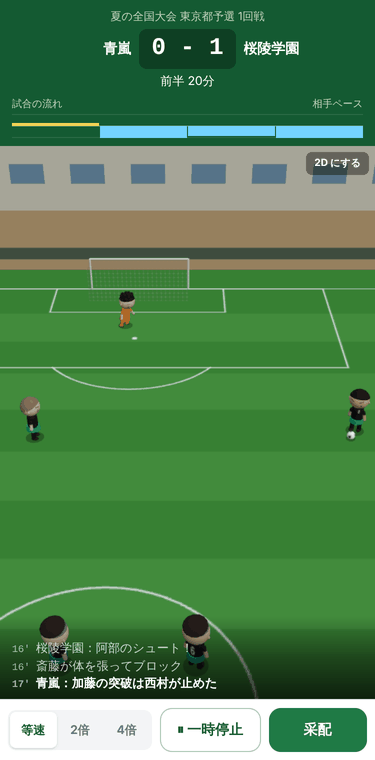 | 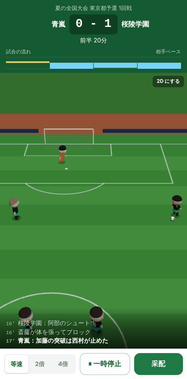 | 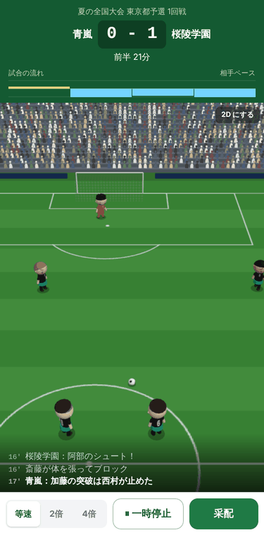 | 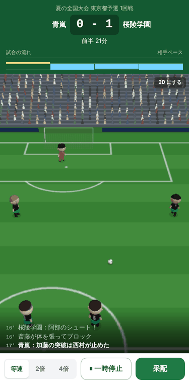 |

- 観戦画面を開いたときだけ three を読み込みます（`next/dynamic`。ほかの画面のファイルには入りません）。読み込み中は「スタジアムを準備しています」を出し、試合の時計は止めておきます。
- 選手の位置とボールの位置は 2D と同じ演出タイムライン（`frameAt`）をそのまま使い、3D ではボールの高さ（浮き球・シュート・ヘディング）、体の向き、動き、カメラを足しています。
- 動き：待機・歩く・走る（速さから自動で選ぶ）、パス・ロングキック・シュート・クロス・トラップ（足・胸）・ヘディング、GK の構え・横へ跳ぶ・キャッチ・高い所で取る・弾く。FK・CK と GK のキックは、4b で専用の動きを作るまでロングキックの動きを使っています。
- イベントの全種類について、どの選手がいつどの動きをするかを `src/engine/replay/motion.ts` の表で決めています（4b の動きの分も表には入れてあり、4b で姿勢を作れば再生されます）。単体テストで全種類と、延長・PK 戦・退場・ケガ・交代のある試合を確かめています。
- 画面：上はスコアボードと試合の流れ（今までどおり）、真ん中が 3D、3D の下のほうに速報の直近 3 行を重ねています（タップで全部の速報）。操作（倍速・一時停止・采配）とハーフタイムは今までどおりです。一時停止中・ハーフタイムは、カメラが止まったら描くのをやめます。
- WebGL が使えない端末では、自動で 2D にして「この端末では 3D を表示できないため、2D で表示しています。」と出します（下の画像の右）。3D の表示が途中で止まったときも 2D に切り替えます。
- 設定：メニューに「トーナメントの観戦の表示（3D／2D＋速報／テキストのみ。標準は 3D）」と「3D の画質（標準／軽量）」を足し、今までの設定は「リーグ戦・練習試合の観戦の表示」になりました（Q14）。

### 1.2 見た目・ユニフォーム・2D

| ユニフォーム（メニュー） | 学校作成 | 選手の詳細 | 2D の丸 | WebGL が使えないとき |
|---|---|---|---|---|
| 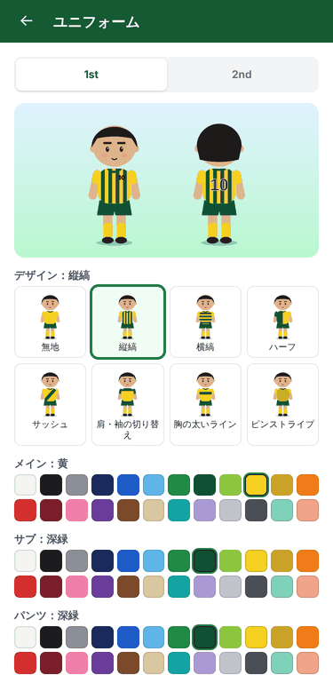 | 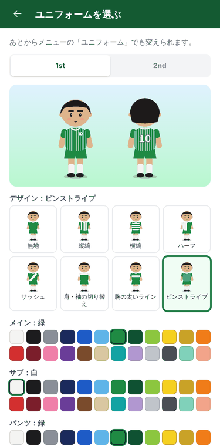 | 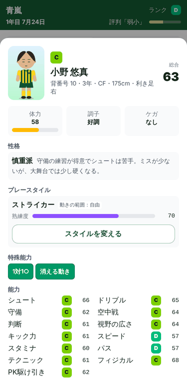 | 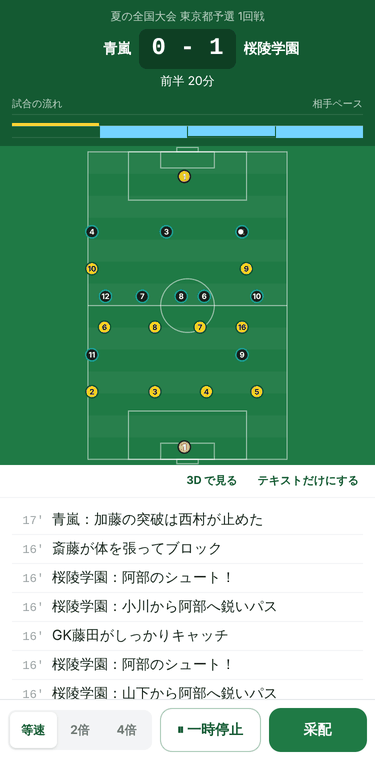 | 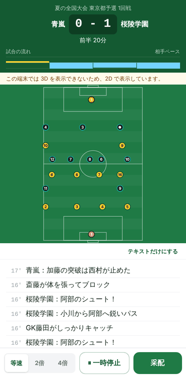 |

- 選手全員（OB も）に見た目（髪型・髪の色・肌の色・目・眉・口）を、試合に出る選手に背番号を、全校にユニフォーム（1st・2nd）を付けました。見た目とユニフォームはゲームの乱数とは別の乱数で作るので、ゲームの進み方は Phase 3 と同じです。
- 補足いただいた 2 点：
  - **背番号**：選手のデータに `shirtNumber` として持たせています。年度の初めに自動で付け直しますが、年度の途中は付いている番号を変えず、空いている番号を足すだけです。Phase 5 で手動の変更を入れるときは、この値を書き換えるだけで済みます。
  - **見た目の種類の追加**：種類は一覧の番号でセーブに入り、一覧は「後ろに足すだけ」の決まりにしました。新しい種類（留学生の髪の色・肌の色など）を出やすさ 0 で後ろに足せば、今までの選手の見た目も、これから生まれる選手の見た目も変わりません（単体テストで確認）。範囲外の番号は 0 として読むので、古いセーブも壊れません。
- ユニフォームの色かぶりは、試合ごとに自動で判定します（アウェーが 2nd、それでもかぶればホームが 2nd、さらにかぶれば予備の無地）。GK の色は両チームのフィールドの色と離れた色を選びます。
- セーブはスキーマ v7 になりました（v6 からの移行のテストつき）。セーブの大きさは 1 年目の終わりのデータで約 12% 増えます（localStorage に 3 枠入ることのテストは通っています）。

### 1.3 体の動き（姿勢）の確認用

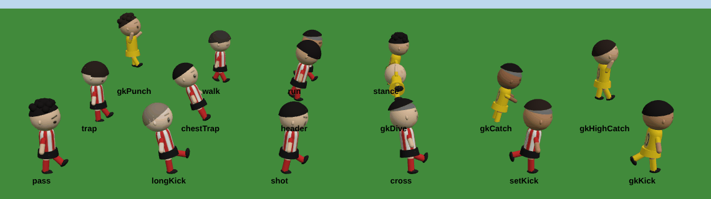

## 2. 計測

### 2.1 大きさ

| 項目 | 結果 | 目標 |
|---|---|---|
| 3D のコード（three ＋ 3D の部分） | 566KB（gzip 142KB）。別のファイルで、観戦を始めたときだけ読み込む | gzip 250KB 以下 |
| トップのページが最初に読み込む JS | 9 ファイル・926KB（gzip 288KB）。3D のコードは入っていません | Phase 3 と同じ（7 ファイル・889KB・gzip 274KB） |

トップのページの JS は gzip で 14KB 増えました。中身はユニフォームの設定画面・選手の絵（SVG）・見た目の生成で、3D のコードではありません（4 章の 1）。

### 2.2 動作（コンテナの中のブラウザ。参考の値）

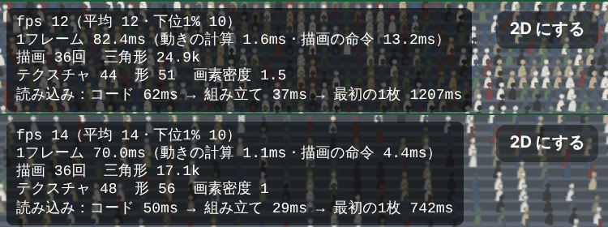

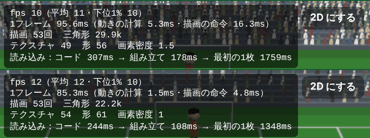

| 項目 | 標準 | 軽量 | CPU 4 倍遅く（標準／軽量） |
|---|---|---|---|
| 動きの計算（1 フレーム） | 1.6ms | 1.1ms | 5.3ms／1.5ms |
| シーンの組み立て | 37ms | 29ms | 178ms／108ms |
| 観戦を開いてから最初の 1 枚 | 1.2 秒 | 0.7 秒 | 1.8 秒／1.3 秒 |
| 描画の回数（ふだんの場面） | 36〜53 回 | 36〜53 回 | |
| 三角形 | 2.5〜3 万 | 1.7〜2.2 万 | |

- コンテナには GPU がなく、絵を CPU で描いているので、fps（10〜14）は実機の目安になりません。動きの計算は CPU を 4 倍遅くしても 1 フレーム 5ms ほどで、30fps（1 フレーム 33ms）に対して十分な余裕があります。
- 描画の回数は目標（標準 150 回・軽量 80 回）を下回っているので、計画 8.2 の「部品ごとのインスタンス描画」への切り替えはしていません。選手は 1 人 6 回（頭・胴・腕 2・脚 2 に形をまとめた）です。
- 読み込みはローカルのサーバーでの値です。4G 回線では、3D のコード（gzip 142KB）の分が加わります。

## 3. テスト・バランス

- lint・型チェック・単体テスト（205 件）・ビルド（静的書き出し）がすべて通りました。
- `balance:quick` の数値は Phase 3 とまったく同じでした（かかった時間の表示を除く）。
- `balance:full`（72 校 × 20 年、30 分）も Phase 3 の報告書の値と同じでした（全国優勝の経験：激戦区 29%・普通 50%・少数 50%、名門は 10 年目など）。
- 「試合の結果の指紋」のテストも Phase 3 の値のままです。

## 4. 計画と違うところ・仮のところ

1. **トップのページの JS が 14KB（gzip）増えた**：計画では「Phase 3 と同じ」を目標にしていました。3D のコードは入っていないので、計画の意図（3D のコードを混ぜない）は守れています。増えた分はユニフォームの設定画面などで、これも観戦と同じように開いたときだけ読み込む形にできます（gzip で数 KB に戻せる見込み）。必要であれば 4b で入れます。
2. **大きさの見せ方**：選手は見やすさのため実寸の約 1.6 倍、ゴールは選手に合わせて約 1.45 倍で描いています（ピッチは実寸）。表示だけの話で、試合には関わりません。
3. **競技場（段階 2・3）に陸上のトラックとピッチの周りの低い板を足しました**：カメラが自校の後ろから見下ろすため、横のスタンドはボールがサイドに寄ったときしか映らず、段階 1 との違いが分かりにくかったためです。板に広告や文字は入れていません。段階 2 と 3 の違い（片側か両側か）は、横のスタンドが映ったときに分かります。
4. **ファイルの分け方**：計画の `pitch.ts` は `stage.ts` にまとめました。
5. **4b に回しているもの**（計画どおり）：残りの動き（守備・ドリブルの技・セットプレー・転倒・カード・喜ぶ／悔しがる）と主審、表情、ゴールの演出（時計を止める演出を含む）、観客の動き、旗と横断幕、PK 戦の 3D（今は PK 戦は今までの画面）、天候とナイター、自動で軽量にする仕組み。

## 5. お願いしたいこと

1. この PR をマージしてください（3D 観戦は Vercel の本番で見られるようになります）。
2. マージの後、お手持ちのスマホで本番（`https://tyoujoueleven.vercel.app/?perf=1`）を開き、トーナメントの試合を 1 試合ほど 3D で見ていただき、左上に出る数値のスクリーンショットを送ってください。標準と軽量の両方だと助かります。この数値（目標は平均 30fps 以上、下位 1% が 20fps 以上）で 4b の調整と、自動で軽量にする基準を決めます。
3. 見た目（選手の大きさ・カメラの高さや近さ）で気になるところがあれば教えてください。4b で直します。
