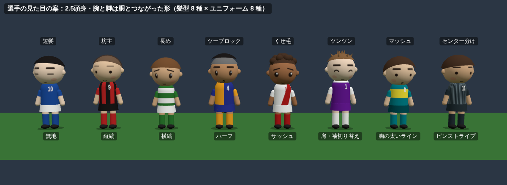
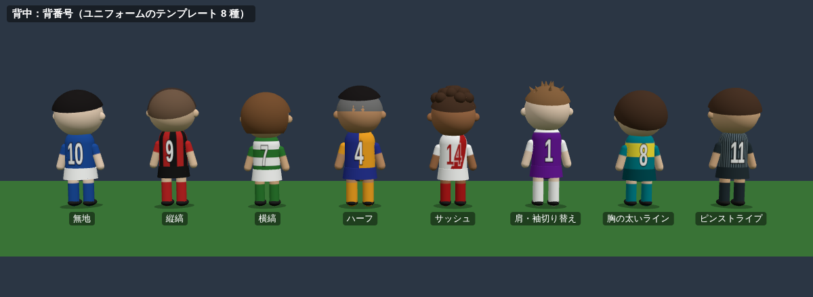
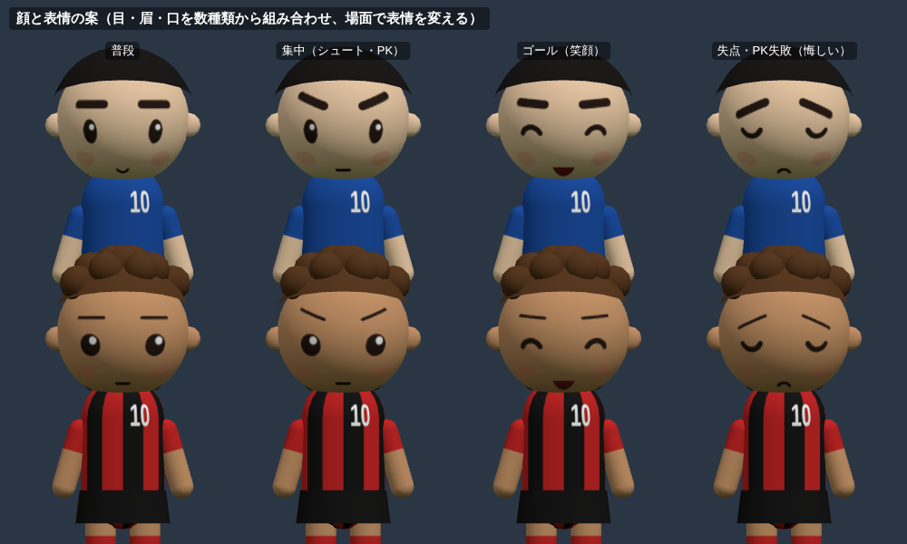
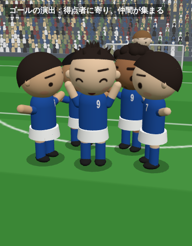
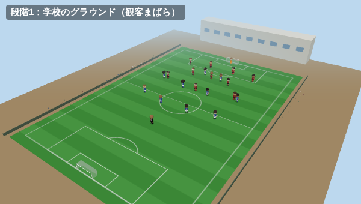
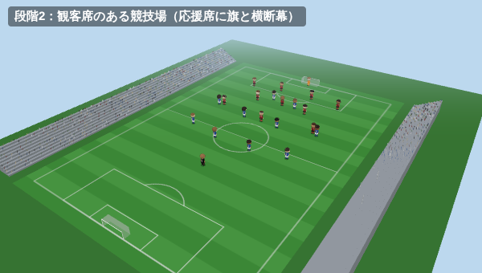
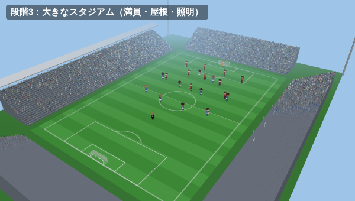
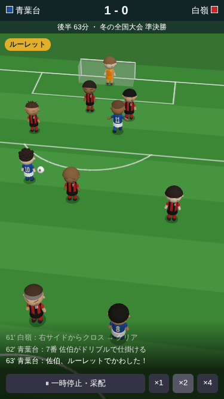
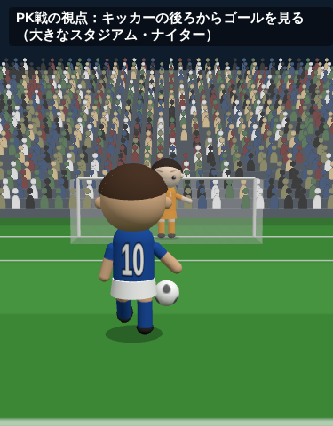

# Phase 4 実装計画（トーナメントの3D観戦・選手の見た目・ユニフォーム）

> 2026-10-13 に承認されました（12 章の Q1〜Q14 はすべておすすめのとおり。Phase 4a から始める）。
> 承認のときの補足：
> 1. Q3：背番号は自動でよいが、Phase 5 で手動で変えられる機能を入れる予定。後から変えられるデータの持ち方にする（9.1 に反映）。
> 2. Q13：Phase 5 の外国人留学生で、髪の色・肌の色の種類を増やす予定。見た目の要素は、後から種類を足してもセーブの互換性が崩れない作りにする（2.2・9.1 に反映）。
> この計画の画像は、計画のためにコードで作った試作の画面です（Three.js で描いて、幅 375px などで撮影）。本実装では形や色を詰めます。

**前提（ブランチ）**：Phase 3（PR #5）は main にマージ済みです。実装は main から作ったブランチ `claude/phase4-9isxzt` で行い、main への PR で進めます。

**Phase 4 の柱**

| # | 柱 | 中身 |
|---|---|---|
| 1 | 3D観戦 | トーナメントの試合を、試合開始から PK 戦まで 3D で再生する。一時停止・采配・倍速・テキスト速報はそのまま（1〜8 章） |
| 2 | 選手の見た目 | 2.5 頭身の独自の体型。髪型・髪の色・肌の色・顔（目・眉・口）を選手ごとに生成して保存。場面で表情が変わる（2 章） |
| 3 | ユニフォーム | 8 種類のテンプレートと 4 か所の色。1st・2nd、色かぶりの自動判定、GK の色（3 章） |
| 4 | セーブ v6→v7 | 全選手に見た目と背番号、全学校にユニフォーム（9 章） |

---

## 1. 3D の技術構成

### 1.1 ライブラリ：Three.js をそのまま使う（React Three Fiber は使わない案）

| | Three.js をそのまま | React Three Fiber（R3F） |
|---|---|---|
| 書き方 | 命令的（シーンを作って、毎フレーム位置を更新する） | React のコンポーネントでシーンを書く |
| 読み込みの大きさ | three だけ（計画の試作をまとめると gzip で 190KB） | three ＋ R3F（さらに 40〜50KB 前後） |
| この作品との相性 | 演出タイムラインから毎フレーム 22 人＋ボールの姿勢を計算して当てはめるので、命令的に書く方が素直。描く・止めるの制御（一時停止中は描かない、など）もしやすい | React の再描画を避ける工夫（ref で直接いじる）が結局必要になる |

**おすすめ：Three.js をそのまま使い、React からは 1 つのコンポーネント（`<Match3D>`）で包む**（Q1）。バージョンは決まった版に固定します（今の最新は 0.186）。

### 1.2 読み込み方：観戦画面を開いたときだけ

- `MatchScreen` は、表示が「3D」のときだけ `import("@/view3d/Match3D")` で 3D のコードを読み込みます（Next.js の `next/dynamic`、SSR なし）。ほかの画面（ホーム・選手・メニューなど）からは 3D のコードを静的に import しません。
- 静的書き出し（`output: 'export'`）のままで、3D のコードは別のファイル（チャンク）に分かれて、観戦を始めたときに読み込まれます。
- 読み込み中は「スタジアムを準備しています」を出し、その間も試合の時計は進めません（読み込みが終わってから再生を始める）。
- **確認**：ビルドの出力で、トップのページが最初に読み込む JS の合計が Phase 3 と同じであること（3D のチャンクが混ざっていないこと）を測って報告します（8.3）。

### 1.3 ファイルの構成

| 場所 | 中身 | 決まりごと |
|---|---|---|
| `src/engine/look/` | 見た目の生成、背番号の付け方、ユニフォームのテンプレート・色かぶりの判定・GK の色・CPU 校のユニフォームの生成 | 純粋な TypeScript（エンジンの決まりどおり。React・DOM を使わない）。単体テストを書く |
| `src/engine/config/look.ts` | 髪型・髪の色・肌の色・顔のパーツの種類と出やすさ、色のパレット、色かぶりの基準値、会場の段階 | バランス用の数値と同じく config に集める |
| `src/engine/config/names.ts` | 髪型・テンプレートの表示名、横断幕の文言など | 表示名はここ |
| `src/engine/replay/motion.ts` | 演出タイムライン → モーションの台本（誰が・いつ・どの動き・表情・カメラ・観客の盛り上がり） | 純粋な TypeScript。three は使わない。単体テストを書く |
| `src/view3d/` | 3D の描画（シーン、スタジアム、キャラクターの組み立て、テクスチャ、モーションの再生、カメラ、画質、WebGL の判定） | 観戦画面からだけ動的に読み込む。`src/engine` には置かない |
| `src/components/look/` | 選手の顔・全身、ユニフォームの絵（SVG） | 選手の詳細・ユニフォームの設定・学校作成で使う。3D のコードは使わない（Q7） |

`src/view3d/` の中は、`Match3D.tsx`（React の入口）、`stage.ts`（会場）、`pitch.ts`、`crowd.ts`、`character.ts`（体の組み立て）、`textures.ts`（Canvas で描くテクスチャ）、`poses.ts`（モーションの姿勢）、`animator.ts`（台本の再生）、`camera.ts`、`quality.ts`、`webgl.ts` に分けます。

---

## 2. キャラクター（選手の見た目）

### 2.1 体型：2.5 頭身・腕と脚は胴とつながった形





- **形**：頭は大きな球、胴は丸みのあるカプセル、腕と脚もカプセルで、**肩と腰で胴にめり込ませてつなげます**（手足が体から離れて浮く形にはしません）。首は作らず、頭を胴に直接のせます。耳は小さな球、靴は平たい楕円の球です。
- **頭身**：頭 1 に対して体が約 1.5（2.5 頭身）。
- **身長**：`heightCm` を体の高さに反映します（頭の大きさは同じで、脚と胴が伸びる）。160cm で 0.92 倍、195cm で 1.08 倍くらい。長身 FW や PK 専門 GK は頭ひとつ近く高く見えます（上の画像の「坊主・縦縞」と「ツンツン・肩切り替え」が高い例）。
- **体の厚み**：フィジカルの能力で胴と脚の太さを 0.9〜1.12 倍に変えます（上の画像の「ツーブロック・ハーフ」が厚い例）。
- **ポリゴン数**：1 人 1,500 三角形前後に抑えます（球・カプセルの分割を少なくする）。

### 2.2 見た目の要素（選手ごとに生成して保存）

| 要素 | 種類 | 出やすさの案 |
|---|---|---|
| 髪型 | 8 種類：短髪、坊主、長め、ツーブロック、くせ毛、ツンツン、マッシュ、センター分け | 短髪・坊主・ツーブロックが多め |
| 髪の色 | 6 色：黒、こげ茶、茶、明るい茶、赤みの茶、灰みの黒 | 黒とこげ茶で 8 割。明るい茶はまれ（Q13） |
| 肌の色 | 5 段階 | 中間の 3 段階が多め |
| 目 | 6 種類（点、たて長、丸に光、細め、たれ目、つり目） | 均等 |
| 眉 | 5 種類（まっすぐ、上がり、太い、細い、下がり） | 均等 |
| 口 | 4 種類（一文字、小さな笑み、大きな笑み、すぼめ） | 均等 |

- 組み合わせは 8×6×5×6×5×4 = 28,800 通りです。
- **種類を後から足せる作り（承認時の補足 2）**：要素ごとの種類は config の一覧の**番号**で保存し、一覧は**後ろに足すだけ**（並べ替え・削除はしない）にします。新しい種類（留学生の髪の色・肌の色など）は一覧の後ろに足し、ふつうの新入生の出やすさは 0 にしておけば、今までの選手の見た目も、これから生まれる日本人の選手の見た目も変わりません。要素そのもの（例：ひげ）を足すときも、保存の配列の後ろに足し、無い古いセーブは 0（なし）として読みます。
- **生成の乱数は、ゲームの乱数とは別の系統にします**：選手の ID とゲームのシードから作ったシード付き乱数（`Rng.fromSeed`）で生成します。ゲームの乱数の並びを 1 つも消費しないので、**新入生の生成などの結果が Phase 3 とまったく同じになり、`balance:quick` の数値も変わりません**。同じ ID なら必ず同じ見た目になります（テストで確認）。
- 新入生・特待生・CPU 校の選手・架空の OB も同じ関数で生成します。卒業して OB になるときは見た目を引き継ぎます。

### 2.3 顔と表情



- 顔は頭の球の正面に、目・眉・口の小さな板（デカール）を貼って描きます。パーツの絵は 1 枚のテクスチャ（アトラス）にまとめ、全員で共有します（選手ごとに顔のテクスチャを作るとスマホのメモリを使いすぎるため）。肌の色は頭の材質の色で変えます。
- **表情**は 4 種類＋1 です。

| 表情 | 使う場面 |
|---|---|
| 普段 | ふだん（選手の目・眉・口のまま） |
| 集中 | シュート・PK を蹴る直前、PK を待つ GK |
| 笑顔 | ゴールした側の全員（特に得点者）、PK 戦に勝った側、試合に勝った側 |
| 悔しい | 失点した側、シュート・PK を外した選手、PK 戦・試合に負けた側 |
| 痛い（目をつぶる） | ファウルを受けて倒れた選手、ケガをした選手 |

### 2.4 ユニフォームの描き方

- シャツの柄（テンプレートと色）は、チームごとに 1 枚、Canvas で描いたテクスチャを胴に巻きます。袖の色はテンプレートに合わせて腕の上側を塗ります（例：「肩・袖の切り替え」は袖がサブの色）。
- **背番号**は数字のアトラス（0〜9）から背中と胸に小さな板で貼ります。チームのテクスチャを選手ごとに作らずにすむので、テクスチャは 1 チーム 1 枚で済みます。
- パンツは円柱、ソックスは脚の下側の色、靴は黒。
- 背番号の色はメインの色の明るさから白か黒を自動で選び、縁取りを付けます。

### 2.5 背番号の付け方（Q3）

今のゲームには背番号がないので、付け方を決める必要があります。

- **おすすめ**：年度の初め（新入生が入った後）に自動で付け直す。GK の一番手が 1、今のフォーメーションの先発 11 人が位置に合わせて 2〜11（DF 2〜5、MF 6〜8、FW 9・11、攻撃の中心の選手に 10）、残りは 12 番から学年と総合値の順。年度の途中は変えません（途中で入る選手は空いている番号の小さい順）。CPU 校も同じ決まりです。
- 2D の丸に書く番号も、今の「並びの枠の番号」から背番号に変えます。
- 背番号を自分で変える機能は、Phase 4 では作りません（要望があれば Phase 5 で）。

---

## 3. ユニフォーム

### 3.1 テンプレート（8 種類）

上の画像の 8 種類です：**無地、縦縞、横縞、ハーフ（左右で色を分ける）、サッシュ（斜めの帯）、肩・袖の切り替え、胸の太いライン、ピンストライプ**。どれも一般的な柄の組み合わせで、特定のクラブ・ブランドのデザインやロゴは使いません。胸のエンブレムやメーカーのマークは付けません。

### 3.2 色

- メインの色・サブの色・パンツの色・ソックスの色の 4 か所を選びます。
- **おすすめ：自由な色ではなく、24 色のパレットから選ぶ**（Q4）。白・黒・灰・紺・青・水色・緑・深緑・黄緑・黄・金・橙・赤・えんじ・ピンク・紫・茶など。パレットにすると、色かぶりの判定とセーブの容量が扱いやすく、どの色を選んでも芝の上で見やすくなります。

### 3.3 1st と 2nd・色かぶりの判定（Q5）

- 学校ごとに 1st と 2nd を持ちます。2nd は、最初は 1st と見分けやすい組み合わせ（白地か、1st の色を入れ替えたもの）を自動で作り、設定で変えられます。
- **ホームとアウェー**：トーナメントは組み合わせ表の上側がホーム、下側がアウェー。リーグ戦は日程どおり（`home`・`away`）。練習試合は自校がホーム。
- **かぶりの判定**：メインの色どうしの近さを、人の目の感じ方に近い色の差（CIELAB の色差）で測り、基準値（例：25）より近ければ「かぶり」とします。
  - かぶったら、アウェー側が 2nd を着ます。
  - アウェーの 2nd もホームの 1st とかぶるとき（まれ）は、ホームが 2nd を着ます。それでもかぶるときは、アウェーが白か黒の無地の予備を着ます。
- 自校の 1st と 2nd が近い色だと 2nd の意味がないので、設定画面で「1st と近い色です」と注意を出します（保存は止めません）。

### 3.4 GK のユニフォーム

- 両チームのフィールド選手の色と、相手の GK の色から最も離れた色を、GK 用の 6 色（黄・橙・黄緑・ピンク・黒・灰）から試合ごとに自動で選びます。学校ごとの設定は持ちません。

### 3.5 CPU 校

- テンプレートは無地・縦縞が少し多めのランダム、メインの色はパレットからランダム、サブは見分けやすい色、パンツとソックスはメインかサブ。2nd は自校と同じ決まりで作ります。

### 3.6 設定する画面

- **学校を作るとき**：学校名と県を決めた後に「ユニフォーム」の画面を 1 枚足します（テンプレートの一覧と色のパレット、おまかせボタン、前と後ろのプレビュー）。
- **あとから**：メニューに「ユニフォーム」を足します。1st と 2nd のタブ、テンプレート、4 か所の色、プレビュー（前・後ろ。背番号 10 の選手）、おまかせボタン。
- プレビューは SVG の絵で描きます（Q7。3D のコードを読み込まない）。3D と同じ柄・色・体型の絵にします。

### 3.7 2D 表示

- 2D の丸を、そのチームのその試合のシャツ（1st か 2nd）のメインの色で塗り、縁をサブの色にします。GK は GK の色。番号の色は明るさで白か黒。今の「自校＝黄、相手＝水色」はやめます（色かぶりの判定があるので見分けられます）。

---

## 4. 演出タイムラインから3Dのモーションへの変換

### 4.1 流れ

```
試合のイベント（MatchState.events）
  → 演出タイムライン（buildTimeline・frameAt。P3 のまま、2D と共通）
      ・各時刻のボールの位置、22 人の位置、浮き球、直前のイベント
  → モーションの台本（新しく src/engine/replay/motion.ts）
      ・イベントごとに「主役の動き」「相手の動き」「周りの反応」「表情」「カメラ」「観客」「技の名前・特殊能力の表示」
  → 3D の再生（src/view3d/animator.ts）
      ・位置：frameAt の位置へ、ばねで滑らかに寄せる
      ・歩く・走る・方向転換：その選手の速さと向きの変化から自動で選ぶ
      ・その上に、台本の動き（キック、タックルなど）を重ねる
```

- 選手の位置とボールの位置は **2D と同じ `frameAt` をそのまま使います**。3D だけの位置の計算は作りません（2D と 3D で場面がずれないように）。
- 3D で足すのは、**ボールの高さ**（浮き球は放物線、シュートはゴールの高さへ、ヘディングは頭の高さ）、**体の向き**、**動き**、**表情**、**カメラ**、**観客**だけです。
- どれも乱数を使わず、イベントの番号から決まった値で散らします（P3 の `jitter` と同じ方法）。同じ試合は何度見ても同じ動きです。

### 4.2 イベントの種類 → 動き（すべての種類で決める）

台本は `Record<MatchEventType, …>` の表で持ち、**イベントの種類が増えたら型のエラーで気づける**ようにします。テストでも全種類を回します。

| イベント | 主役（players[0]） | 相手（players[1]）・周り | カメラ・その他 |
|---|---|---|---|
| kickoff・secondHalf・extraTime・extraSecondHalf | センターサークルでパス | 全員が自陣の位置から | 全体 |
| halfTime・fullTime | — | 全員が歩いて止まる。試合終了は勝った側が喜び、負けた側が悔しがる | 引き |
| pkShootout | — | PK 戦の場面へ切り替え（7 章） | PK の視点 |
| pass・throughBall | パス | 受け手がトラップ | ボールを追う |
| passBlocked | パス | カットした選手がタックル（足を出す） | |
| noOption | トラップして方向転換（後ろへ戻す） | | |
| dribble | ドリブルの技（`move`。4.4） | 抜かれた選手がタックルを空振り | 技の名前を小さく表示 |
| dribbleFail | ドリブルの技の出だし | 奪った選手がタックル。ゴール前・サイドの深い所ではスライディング（決まった値で 3 回に 1 回ほど） | |
| counter | ボールを運んで走る（`move` があれば技） | 周りが一斉に前へ走る | |
| oneOnOne | ボールを運んで走る | GK が構える | 少し寄る |
| gkRush | GK の飛び出し（足元へ倒れ込む） | 相手がつまずく | |
| cross | クロス | ゴール前の選手が走り込む | ゴール前へ |
| header | ヘディング（ジャンプ） | 競り合い（一緒に跳ぶ） | 寄る |
| crossCleared | 守る選手のヘディング（ジャンプ）でクリア | | |
| gkClaim | GK が跳んでキャッチ | | |
| fumble | GK が跳んでキャッチし損ねる（パンチングの形） | | |
| longBall・switchPlay | ロングキック | 受け手がトラップ（高ければ胸） | ボールを追う |
| longBallShort・longBallLost | ロングキック | 相手が競り合い・ヘディング | |
| buildUpError | 奪った選手がタックル | 自陣の選手（GK）がパスをミスして頭を抱える | |
| setPiece | ボールを置く・助走の準備 | 壁を作る | |
| freeKick | FK | 壁がジャンプ | 寄る |
| corner | CK（コーナーへ移動してから蹴る） | ゴール前で押し合う | CK の視点 |
| longThrow | ロングスロー | | |
| shot | シュート（`note` が header ならヘディングシュート、freeKick なら FK） | GK が構える → 跳ぶ | 寄る |
| block | 守る選手が体を投げ出してブロック（スライディング） | | |
| miss | （シュートの後）頭を抱える | 少し後に GK のゴールキック（4.3） | |
| catch | GK のキャッチ（横へのボールなら横へ跳んでキャッチ） | | |
| parry | GK のセービング（横へ跳んで弾く）。正面ならパンチング | | |
| rebound | こぼれ球へ走ってシュート | | |
| goal・pkGoal | 得点者が喜ぶ → チームメイトが集まる | 失点した側は悔しがる、GK は倒れたまま | ゴールの演出（6.3） |
| pkAwarded | ファウルを受けた選手が転倒 | ファウルした選手が手を挙げる | |
| pkMiss・pkSaved | PK（7 章と同じ動き） | GK のセービング | PK の視点 |
| foul | ファウルを受けた選手が転倒 | ファウルした選手がタックル | |
| yellow・secondYellow・red | 主審がカードを出す。選手はうなだれる（レッドは歩いてピッチの外へ） | | カードの色の表示 |
| injury | 倒れたまま（痛い顔）。交代したら歩いて外へ | | |
| sub | 下がる選手が歩いてピッチの外へ、入る選手が走って位置へ | | |
| tactics・formation・position・note・shortHanded | 動きなし（並びが変われば、選手が新しい位置へ走る） | | 速報だけ |

### 4.3 エンジンにないプレーの再開（Q11）

エンジンはスローインやゴールキックをイベントにしていません。3D では、見て自然なように次の再開を**表示だけで**足します（結果・速報には関わりません）。

- シュートが外れた後（miss）：GK のゴールキック。
- イベントのない時間（P3 の「後ろでボールを回す時間」）の始まりで、直前がクリア（crossCleared・longBallLost・block）でサイドの深い所だったとき：その次に攻める側のスローイン。

### 4.4 ドリブルの技（`move`）

| 技 | 動き | ボール |
|---|---|---|
| ダブルタッチ | 片足の内側で横へ、すぐ逆の足で前へ。体は小刻みに左右 | 小さな「く」の字 |
| ルーレット | ボールを足の裏で止めて、体が 360 度回る | 体の周りで半円 |
| 裏街道 | ボールを相手の片側に出し、自分は反対側を回って追いつく | 相手の横を抜ける |
| チョップタッチ | 足の内側で鋭く切り返す。腰を落とす | 急に向きが変わる |
| シザース | ボールをまたぐように足を回す（2 回）→ 逆へ加速 | 止まってから逆へ |

技の名前は、技が発動したとき（`skill` があるとき）に、主役の上に小さく出します（今の速報の特殊能力の名前と同じ文字）。

### 4.5 主審（Q6）

カードの場面（「カードを出される」）とキックオフのために、**主審を 1 人置く**ことをおすすめします。黒の上下、顔は固定、見た目は保存しません。ボールから少し離れた位置について回ります。線審・第 4 審判は置きません。

### 4.6 記録を足すか

今のイベントで足りない情報は、ほかのイベントから表示の側で決められるので、**今のところエンジンへの記録の追加は不要**と見ています。

- 得点したときの GK：その時刻の並び（`shapes`）から相手の GK が分かる。
- クロスの受け手：直後の header のイベントの主役。
- シュートのコース・PK の向き：イベントの番号から決まった値で決める。PK の GK の跳ぶ向きは、キッカーが読み勝ったか（`kickerWonRead`）から決める（読み勝ち＝逆へ跳ぶ）。

実装の途中で足りないものが見つかったら、P3 の `lane`・`zone` と同じく乱数を使わない形で記録だけを足し、P3 で作った「試合の結果の指紋」のテスト（`src/engine/replay/fingerprint.ts`）で、結果と乱数の使い方が変わらないことを確かめます。

### 4.7 時間の進み方

- 等速は 1 分 = 現実の 4 秒です。1 分の中のイベントの間隔は最短 0.25 分（1 秒）なので、動きは 0.5〜1 秒に収めます。2 倍・4 倍のときは動きも速く再生し、短くできない動き（ジャンプなど）は途中から始めます。
- **ゴールの演出のあいだは、試合の時計を止めます**（Q10）。等速で 3.5 秒、2 倍で 2 秒、4 倍で 1.2 秒。画面をタップすると飛ばせます。止めるのは表示の時計だけで、結果には関わりません。

---

## 5. モーションの一覧と作り方

### 5.1 作り方

- 体を 8 つの部品（腰＝体全体、胴、頭、左右の腕、左右の脚、ボールを持つときの手の位置）に分け、それぞれの回転と体全体の上下・傾きを「姿勢」として持ちます。
- 1 つのモーションは「姿勢のキーフレームの並び（時刻 0〜1）」と長さで書きます（コードのデータ。外部のアニメーションファイルは使いません）。キーフレームの間はなめらかにつなぎます。
- **歩く・走る**は、速さに合わせた周期の脚・腕の振りを計算で作ります（キーフレームではなく正弦波）。速さが 0.5m/s 未満なら待機、3m/s 未満なら歩く、それ以上は走る。向きが急に変わったら方向転換のモーションを挟みます。
- 台本の動き（キックなど）は、歩く・走るの上に重ねます。脚を使う動き（キック）のあいだは脚の振りを止め、腕だけの動き（喜ぶ）は脚の振りを残します。
- 動きと動きの間は 0.1 秒かけて混ぜます。

### 5.2 一覧

| 分類 | モーション | 長さ（等速） | 作り方のメモ |
|---|---|---|---|
| 基本 | 待機 | くり返し | 体を小さく上下、ときどき足踏み |
| | 歩く・走る | くり返し | 速さで周期と振りの大きさが変わる |
| | 方向転換 | 0.3 秒 | 外側の足で踏ん張って体を回す |
| ボール | パス | 0.5 秒 | 軸足を踏み込み、蹴り足を振る。ボールは地面を転がる |
| | ロングキック | 0.7 秒 | 大きく振りかぶる。体を後ろへ傾ける |
| | シュート | 0.6 秒 | 腕を広げて強く振り抜く |
| | クロス | 0.6 秒 | 体を開いて巻くように振る |
| | トラップ | 0.4 秒 | 足の裏・胸（ボールの高さで切り替え） |
| | ヘディング（ジャンプ） | 0.7 秒 | 跳んで頭を振る。競り合いは 2 人で同時に跳ぶ |
| 守備 | タックル | 0.5 秒 | 片足を伸ばして体を寄せる |
| | スライディングタックル | 0.9 秒 | 低く滑り込む（体が倒れて地面を滑り、起き上がる） |
| | 競り合い | 0.6 秒 | 肩を当てて押し合う／一緒に跳ぶ |
| GK | 構え | くり返し | 腰を落として両手を前に |
| | セービング | 0.9 秒 | 横へ跳んで体を伸ばし、倒れて起き上がる |
| | キャッチ | 0.5 秒 | 胸の前で抱える／跳んで高い位置で |
| | パンチング | 0.6 秒 | 跳んで片手・両手で弾く |
| | ゴールキック | 0.8 秒 | ボールを置いて助走して蹴る |
| | 飛び出し | 0.8 秒 | 前へ走って足元へ倒れ込む |
| ドリブルの技 | 5 種類 | 0.6〜0.9 秒 | 4.4 のとおり |
| セットプレー | スローイン・ロングスロー | 0.8 秒 | 両手で頭の後ろから。ロングスローは助走してから大きく反る |
| | FK・CK | 0.9 秒 | 助走してから蹴る（CK はコーナーから） |
| | PK | 1.2 秒 | 助走 → 蹴る（7 章） |
| その他 | 転倒 | 1.2 秒 | 前へ倒れて転がり、しばらくしてから起き上がる |
| | ゴールの喜び | 3 秒 | 両手を上げて走る → 仲間が集まって輪になる（得点者ごとに 3 種類から決まった値で選ぶ：両手を広げて走る、こぶしを突き上げる、ひざで滑る） |
| | 失点後に悔しがる | 2 秒 | 腰に手・しゃがむ・地面をたたく |
| | カードを出される | 1.5 秒 | 主審がカードを上げ、選手がうなだれる |



---

## 6. スタジアムと演出

### 6.1 会場の段階（Q8）

| 段階 | 会場 | 使う試合 | 観客 |
|---|---|---|---|
| 1 | 学校のグラウンド（柵・校舎・ベンチ） | 冬・夏の県予選と新人戦の県大会の、準々決勝より前 | 立ち見がまばら（数十人） |
| 2 | 小さな競技場（片側にスタンド） | 県予選の準々決勝・準決勝、新人戦の県大会の準々決勝から、新人戦の地域大会 | 3 割ほど |
| 3 | 競技場（両側にスタンド） | 県予選の決勝、全国大会（夏・冬）の準々決勝まで | 5〜7 割 |
| 4 | 大きなスタジアム（4 面のスタンド・屋根・照明塔） | 冬の全国大会の準決勝・決勝、夏の全国大会の決勝 | ほぼ満員 |







- **ピッチ**：芝の刈り込みの縞模様、ライン、ゴールとネット（どれも Canvas で描いたテクスチャ）。
- **観客**：人の形の板を 1 回の描画（インスタンス描画）でまとめて出します。色は人ごとに変え、自校の応援席（ホーム側のゴール裏ではなく、片側のスタンドの中央）は学校の色の人を多くします。
- **観客の動き**：決定機（シュート、ゴール前のクロス・1 対 1）で立ち上がる・跳ねる、ゴールで大きく跳ねる・手を上げる。遠くの観客は動かさない（軽量の画質では動かさない）。
- **応援の旗と横断幕**：自校の応援席に、学校のメインとサブの色の旗（数本、揺れる）と横断幕。横断幕の文言は `names.ts` の中から決まった値で選びます（例：「頂上へ 全員で走れ」「一球入魂」など。実在のチームのものは使いません）。段階 1 ではベンチの横に旗だけ。
- 紙吹雪は出しません。

### 6.2 天候と昼・夜（Q9）

- **おすすめ**：Phase 4b で「晴れ・曇り」と「ナイター」を入れます。雨（降る粒、暗い空、ピッチの照り）は動作が重くなりやすいので、4b の最後に余裕があれば入れ、なければ Phase 5 に回します。
- 天候は表示だけで、試合の結果には関わりません（エンジンに天候はありません）。試合ごとに、試合の ID から決まった値で選びます（晴れ 6・曇り 3・雨 1 の割合）。
- ナイターは、段階 4 の試合と、夏の全国大会の一部の試合（暑さを避けた夕方〜夜の試合という設定）。照明塔の光と、空の色・明るさを変えます。

### 6.3 ゴールの演出

1. ボールがネットを揺らす（ネットの板を少し後ろへふくらませる）。
2. カメラが得点者へ寄る（約 1 秒）。得点者は笑顔で喜びのモーション、チームメイトが走って集まる。
3. 失点した側は悔しがる。観客が跳ねる（自校の得点なら応援席の旗も大きく振る）。
4. スコアボードが光り、速報に得点が出る。
5. 時計が動き出し、キックオフの位置へ戻る（4.7）。

---

## 7. カメラと PK 戦

### 7.1 カメラ



- **ふだん**：自校が下から上へ攻める向き（2D と同じ）で、斜め上から見下ろします（角度 40 度前後、ピッチの縦 40m・横 35m くらいが映る広さ）。ボールの位置を、ばねで遅れて追います（急に動かない）。ボールが横に動いたときは少しだけ追い、縦の動きをしっかり追います。
- **ゴール前**：ボールが相手のペナルティエリアの近くにあるときは、少し寄って低くします（1 対 1・シュート・クロス）。
- **セットプレー**：CK はコーナーの後ろ寄り、FK はキッカーの後ろ寄りに回り込みます。
- **ゴール**：得点者へ寄る（6.3）。
- **一時停止中**：カメラは止めたまま。描くのも止めて、電池を使わないようにします。
- 画面の構成：3D は画面の上から下まで使い、上にスコアボードと試合時間、下にテキスト速報（直近 3 行）と操作（一時停止・采配、×1・×2・×4）を重ねます。技の名前・特殊能力の速報は左上に出します。

### 7.2 PK 戦



- キッカーの後ろからゴールを見る視点。キッカーは集中の顔で助走して蹴り、GK は跳びます（読み勝ちの結果に合わせた向き）。
- 決まったらキッカーが笑顔で仲間のところへ、外したら悔しがる（GK は止めたら喜ぶ）。ほかの選手はセンターサークルで肩を組んで並びます。
- 今の PK 戦の画面（キッカーの順番を決める、結果の一覧）はそのまま使い、蹴る場面だけを 3D にします（順番を決める画面 → 3D で 1 本ずつ → 結果）。
- ハーフタイム：今のハーフタイムの画面（采配・前半の分析）を、止めた 3D の上に重ねます。

---

## 8. スマホでの動作

### 8.1 目標

| 項目 | 目標 |
|---|---|
| fps（標準の画質、中くらいのスマホ） | 平均 30fps 以上、下位 1% が 20fps 以上 |
| fps（軽量の画質、少し古いスマホ） | 平均 30fps 前後 |
| PC | 平均 55fps 以上 |
| 3D のコードの大きさ | gzip で 250KB 以下（three ＋ 3D の部分） |
| 観戦を押してから最初の 1 枚が出るまで | 4G 回線で 2.5 秒以内（コードの読み込み ＋ シーンの組み立て。シーンの組み立ては 0.5 秒以内） |
| ほかの画面の読み込み | トップのページが最初に読み込む JS の合計が Phase 3 と同じ（3D のコードが混ざらない）。Phase 3（main）の実測は 7 ファイル・889KB（gzip 274KB） |
| 描画の回数（1 フレーム） | 標準 150 回以下、軽量 80 回以下 |

「中くらいのスマホ」は、数年前の普及価格帯の機種（例：発売から 3〜4 年の中位の Android、iPhone SE 第 2 世代くらい）を想定しています。

### 8.2 対策

- 低ポリゴン（1 人 1,500 三角形前後、観客は 1 人 2 三角形）、材質は光の計算が軽いもの（Lambert）、本物の影は使わず足元の丸い影。
- 観客・旗はインスタンス描画で 1〜2 回の描画にまとめる。テクスチャは共有（顔のパーツ・数字のアトラス、チームごとのシャツ 1 枚）。
- 選手は、まず「1 人 = 部品のまとまり」で作り、描画の回数が目標を超えたら、部品ごと（全員の頭、全員の胴…）のインスタンス描画に切り替えます（作業の順番の中で計測してから判断）。
- 画素密度の上限：標準 1.5、軽量 1.0。
- 一時停止中・ハーフタイムは描かない。画面が見えないとき（別のタブ）も描かない。
- **画質の設定（標準／軽量）**：軽量では、観客を半分、遠くのスタンドの観客は板 1 枚の絵、旗を揺らさない、丸い影をなくす（選手の真下に薄い円だけ）、画素密度 1.0、ふちのギザギザを消す処理（アンチエイリアス）なし、雨なし。
- **自動で軽量に**（Q12）：標準で観戦を始めて最初の 10 秒の平均が 24fps 未満なら、自動で軽量に切り替えて「動作が重いため軽量の画質にしました（設定で変えられます）」と出します（1 回だけ。設定に保存）。

### 8.3 計測の方法

- 開発用の計測の表示（観戦画面の URL に `?perf=1` を付けると出る）：fps（直近 1 秒、60 秒の平均、下位 1%）、1 フレームの時間、描画の回数、三角形の数、テクスチャの数。読み込み時間（観戦を押す → コードの読み込み完了 → シーンの組み立て完了 → 最初の 1 枚）。
- **私が測るもの**：コンテナの中のブラウザ（Chromium）で、CPU を 4 倍遅くした条件の fps と読み込み時間、ビルドの出力の大きさ（トップのページの最初の JS の合計と、3D のチャンクの大きさを Phase 3 と比べる）。ただしコンテナには GPU がないので、fps は参考の値です。
- **実機での確認をお願いしたいもの**（Q12）：Vercel のプレビューの URL で、お手持ちのスマホで `?perf=1` を付けて 1 試合を見ていただき、表示された数値（スクリーンショット）を教えていただく。これを目標と比べて調整します。

---

## 9. セーブデータ（スキーマ v6 → v7）

### 9.1 足すもの

| 対象 | 足すもの | 保存の形 |
|---|---|---|
| 全選手（自校・CPU 校） | 見た目 `look`、背番号 `shirtNumber` | `[背番号, 髪型, 髪の色, 肌の色, 目, 眉, 口]` の数の配列で、圧縮した選手の配列（`PackedPlayer`）の決まった位置に足す。種類は config の一覧の番号（後ろに足すだけ）。要素が増えたら配列の後ろに足す |
| OB（実在・架空） | 見た目 `look` | 選手と同じ要素（数の配列のもとになるオブジェクト） |
| 全学校 | ユニフォーム `kits: { first, second }`（テンプレート、メイン・サブ・パンツ・ソックスの色。色はパレットの番号） | 小さなオブジェクト |
| 試合中の選手（`MatchPlayer`） | 見た目と背番号の写し（表示用。計算には使わない） | 試合の途中のセーブに入る |
| 試合（`MatchState`） | その試合で着るユニフォーム（1st か 2nd、GK の色）とホーム側 | 試合を作るときに決める |

- **背番号は選手ごとの値として保存します（承認時の補足 1）**。自動の付け直しは「その値を書き換える」処理なので、Phase 5 で手動の変更を入れるときは、選手に「手動で決めた」の印を足して、自動の付け直しでその選手を飛ばすだけで済みます。
- 容量の見込み：選手 1 人あたり十数文字増えます。全体で数％の増加の見込みです（実装のときに今のセーブの大きさと比べて報告します）。

### 9.2 マイグレーション（v6 → v7）

- 全選手・OB に見た目を生成して付けます（2.2 の別系統の乱数。同じセーブなら何度読み込んでも同じ見た目）。
- 背番号を 2.5 の決まりで付けます。
- 全学校にユニフォームを付けます（CPU 校の決まりで生成。自校もいったん自動で作る）。
- 試合の途中のセーブ（`activeMatch`）には、見た目・背番号の写しとユニフォームを付けます。
- お知らせ（ログ）に「ユニフォームが付きました。メニューの『ユニフォーム』から自由に変えられます」を出します。
- テスト：Phase 3 のセーブ（`src/lib/save/fixtures/` に v6 のセーブを足す）を読み込むと、全員に見た目と背番号、全学校にユニフォームが付き、そのまま 1 日進められること。2 回読み込んでも同じ見た目になること。

### 9.3 設定（ブラウザに保存している設定）

- **トーナメントの表示**の設定を新しく足します：「3D／2D＋速報／テキストのみ」、標準は 3D（Q14）。
- 今の「観戦の表示」は、リーグ戦・練習試合の表示（2D＋速報／テキストのみ）として残します。今の設定は「トーナメントを含むすべての試合」なので、P3 で 2D を選んでいた人も、トーナメントは一度 3D になります（設定で 2D に戻せます）。
- 「3D の画質（標準／軽量）」を足します。標準は「標準」。

---

## 10. テストと確認

### 10.1 単体テスト（Vitest）

| テスト | 中身 |
|---|---|
| 色かぶりの判定 | 同じ色・近い色・遠い色、アウェーの 2nd もかぶる場合、GK の色が両チームと離れていること |
| 見た目の生成 | 同じシードと ID で同じ見た目、要素がすべて範囲内、出やすさがだいたい設定どおり（大量に生成して確かめる） |
| 背番号 | GK の一番手が 1、重複がない、年度の途中は変わらない |
| モーションへの変換 | **すべてのイベントの種類**で動きが決まること。いろいろな試合（延長・PK 戦・退場・ケガ・交代のある試合）の全イベントで台本が作れること。同じ試合で何度作っても同じ台本 |
| 記録を足しても結果が変わらない | 「試合の結果の指紋」のテストを Phase 4 の変更の後も通す（エンジンを変えない確認） |
| セーブのマイグレーション | 9.2 のとおり |
| ゲームの乱数を使っていない | 見た目の生成を入れても、新入生の能力・CPU 校の部員など、ゲームの結果が Phase 3 と同じこと（同じシードで 1 年進めた結果を比べる） |

3D の描画（`src/view3d/`）は単体テストの対象外にし、画面の確認で見ます。

### 10.2 画面の確認（幅 375px のスクリーンショットを報告に付ける）

3D 観戦（ふだんの時間帯、ゴールの場面、PK 戦）、軽量の画質、WebGL が使えないときの 2D への切り替え、ユニフォームの設定画面、学校作成のユニフォームの画面、選手の詳細の見た目、2D の丸の色。

### 10.3 バランス

試合エンジンは変えないので、`npm run balance:quick` の数値が Phase 3 と**まったく同じ**になることを確かめます（見た目の生成でゲームの乱数を使わないため、誤差の範囲ではなく同じ値になるはずです）。PR の前の `balance:full` も同じ考えで、Phase 3 の報告書の値と比べます。

---

## 11. 作業の順番（Phase 4a・4b に分ける案。Q2）

量が多いので、**4a（土台と、まず 3D で見られるところまで）と 4b（動きと演出の仕上げ）**に分け、**4a で一度 PR をマージ**して、実機で重さを確かめてから 4b に進むことをおすすめします。

### Phase 4a

1. SPEC・計画の承認の反映。
2. 見た目・背番号・ユニフォームのデータと生成（`src/engine/look/`、config、names）＋単体テスト。
3. セーブ v7 のマイグレーション＋テスト。
4. ユニフォームの設定画面（メニュー）と学校作成の画面、SVG の顔・全身の絵、選手の詳細に見た目を表示。
5. 2D の丸をユニフォームの色と背番号に。
6. 3D の土台：動的な読み込み、WebGL の判定と 2D への自動切り替え、会場（段階 1〜4 の形だけ）、キャラクター、歩く・走る・待機・方向転換、ボールの高さ、カメラが追う、スコアボード・速報・一時停止・采配・倍速、ハーフタイム。
7. 基本のボールの動き（パス・ロングキック・シュート・クロス・トラップ・ヘディング）と GK の構え・セービング・キャッチ。
8. 計測の表示（`?perf=1`）、画質の設定（標準／軽量）、大きさの確認。
9. lint・テスト・ビルド・`balance:quick`。4a の報告とスクリーンショット → PR を準備完了に → マージ後に実機での計測をお願いする。

### Phase 4b

1. 残りのモーション（守備、GK の残り、ドリブルの技 5 種類、セットプレー、転倒、カード、喜ぶ・悔しがる）と主審。
2. 表情、ゴールの演出、観客の動き、旗と横断幕。
3. PK 戦の 3D。
4. 天候（晴れ・曇り）とナイター。余裕があれば雨。
5. 実機の計測の結果で調整、自動で軽量にする仕組み。
6. lint・テスト・ビルド・`balance:quick`・`balance:full`。報告書（`docs/PHASE4_REPORT.md`）とスクリーンショット、fps と読み込み時間の結果。

---

## 12. 決めていただきたいこと

| # | 決めていただきたいこと | おすすめ |
|---|---|---|
| Q1 | 3D のライブラリ | Three.js をそのまま使う（React Three Fiber は使わない）。読み込みが小さく、毎フレームの更新を素直に書ける（1.1） |
| Q2 | 作業の分け方 | 4a（土台と、まず 3D で見られるところまで）と 4b（動きと演出の仕上げ）に分け、4a で一度 PR をマージして実機で重さを確かめる（11 章） |
| Q3 | 背番号の付け方 | 年度の初めに自動で付け直す（GK の一番手が 1、先発が位置に合わせて 2〜11、攻撃の中心に 10、残りは 12 から）。年度の途中は変えない。自分で変える機能は作らない。2D の番号も背番号にする（2.5） |
| Q4 | ユニフォームの色の選び方 | 24 色のパレットから選ぶ（自由な色は選べない）（3.2） |
| Q5 | ホーム・アウェーと色かぶり | トーナメントは組み合わせ表の上側がホーム、リーグ戦は日程どおり、練習試合は自校がホーム。メインの色の差（CIELAB）が基準値より近ければアウェーが 2nd。それでもかぶればホームが 2nd、さらにかぶれば予備の無地（3.3） |
| Q6 | 主審を置くか | 置く（黒の上下・顔は固定・保存しない）。カードとキックオフの場面に使う。線審は置かない（4.5） |
| Q7 | 選手の詳細・ユニフォームの設定の絵 | SVG の絵で描く（3D と同じ柄・色・体型）。3D のコードは観戦画面だけで読み込むため（1.3、3.6） |
| Q8 | 会場の段階 | 4 段階（グラウンド → 小さな競技場 → 競技場 → 大きなスタジアム）。大きなスタジアムは冬の全国大会の準決勝・決勝と、夏の全国大会の決勝（6.1） |
| Q9 | 天候と昼・夜 | 4b で晴れ・曇りとナイター（段階 4 と夏の全国大会の一部）。雨は余裕があれば 4b、なければ Phase 5。どれも表示だけ（6.2） |
| Q10 | ゴールの演出の時間 | 演出のあいだは表示の時計を止める（等速 3.5 秒・2 倍 2 秒・4 倍 1.2 秒）。タップで飛ばせる（4.7） |
| Q11 | エンジンにない再開の表示 | シュートが外れた後の GK のゴールキックと、サイドの深い所でクリアした後のスローインを、表示だけで足す（速報には出さない）（4.3） |
| Q12 | 動作の計測と重いとき | 目標は 8.1 の表。実機の計測は、4a のマージ後にプレビューで `?perf=1` を付けて見ていただく。最初の 10 秒が 24fps 未満なら自動で軽量の画質にする（8.2・8.3） |
| Q13 | 髪の色 | 黒とこげ茶が中心、茶・赤みの茶・灰みの黒が少し、明るい茶はまれ。金髪などの明るい色は入れない（高校の部活らしさのため）（2.2） |
| Q14 | 表示の設定の分け方 | 「トーナメントの表示（3D／2D＋速報／テキストのみ、標準は 3D）」を新しく足し、今の設定はリーグ戦・練習試合の表示として残す。P3 で 2D を選んでいた人も、トーナメントは一度 3D になる（9.3） |
