# Phase R2 報告：ゲームの流れの作り直し

計画は `docs/PHASE_R2_PLAN.md`（2026-10-14 承認。Q1〜Q13 はすべておすすめどおり。試作の 2 点の修正つき）。
画面写真は `docs/phaseR2/final/`（共有フォルダの `phaseR2/final/` に元の大きさの PNG）。途中経過の写真（Q13）は共有フォルダの `phaseR2/checkpoint/`。

---

## 1. まとめ

| 項目 | 結果 |
|---|---|
| すごろくの公開範囲 | 10 日先までだけ見え、その先は「？」。大会・リーグ戦・練習試合の日は、すごろく上ではふつうのマスに見える。分かれ道の先も選ぶまで「？」 |
| 年間の予定表 | 「大会」の画面に「予定」タブを足した。月ごとの行に、大会（赤）・リーグ（黄）・行事（白）・練習試合（申し込みが届いたもの）・月初の指示を並べ、今月の行までスクロールする。1 年目の最初の 3 か月は、ホームに「試合の日は、すごろくでは見えません。予定表で確かめられます」の帯を出す |
| 月初の育成指示 | 毎月 1 日に必ず止まる。左に先月の振り返り、中央に部員の一覧（重点の能力名は 2 段で全部見せる）、右にまとめての操作と「この指示で決定」。1 人の指示では、能力の札をタップして重点（最大 2 つ）を選ぶ。おまかせはヘッドコーチの質で選び方が良くなる。重点は練習の経験点の 20% |
| 学校行事と学力 | 入学式・テスト 5 回（3 日前に「テスト前」の方針を選ぶ）・体育祭・文化祭・修学旅行（2 年生）・卒業式。学力（5 段階の帯と前回の点）、赤点で補習（練習に出られない。試合には出られる）。行事の背景の絵を 6 枚足した（運動会・試験の教室・文化祭・入学式・体育館・旅行） |
| 選択肢のあるイベント | 人物マス（通常マスの約 16%）で 27 種、行事の選択 3 種（テスト前・体育祭・文化祭）、合宿の夜 1 種。選んだ結果で調子・体力・経験点・信頼度などが動く |
| 信頼度 | 0〜100（表示は 5 段階の帯）。調子の安定・月初の指示の効き目・選択肢のイベントの成否だけに効き、試合の計算には入れない |
| せりふ | 今のイベント 19 種と緑・黄・特訓・寄付・練習中のケガ・スタッフの直しにも話し言葉のせりふを足した。性格 5 種で話し方が変わる。せりふは設定データ（`src/engine/config/eventLines.ts` など）にあり、乱数を使わない |
| 場面の決まり | 設定に「大事な出来事だけ場面（標準）／すべて場面／文章だけ」。標準では、選択肢・行事・特殊能力を身につけた・ケガ・OB の直伝・寄付だけを場面にし、体力回復や練習の手応えは速報の帯に流す |
| 試作の 2 点の修正 | (1) 選択肢はせりふの枠のすぐ上に横並びにし、立ち絵は選択肢の上に出す（顔と体に重ならない） (2) 月初の指示の一覧で、重点の能力名を 2 段にして切らずに見せる |
| セーブ | v7 → v8。R1 のセーブ（ふつうの日・大会の最中・観戦中の試合）を読み込んで 1 年遊び続けられることをテストで確認 |

---

## 2. 画面写真（844×390・ノッチの模擬 `?safe=notch`。16〜18 は大きさ違い）

| | |
|---|---|
| 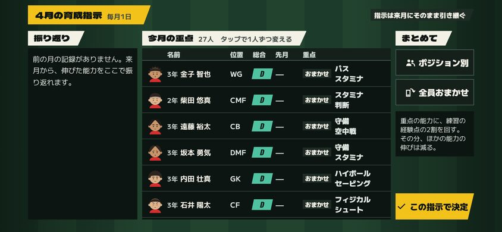 月初の育成指示（重点は 2 段で全部見せる） | 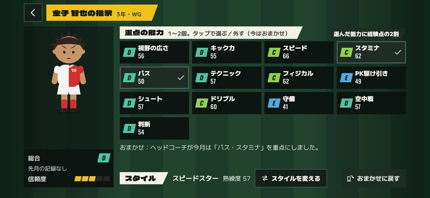 1 人の指示 |
| 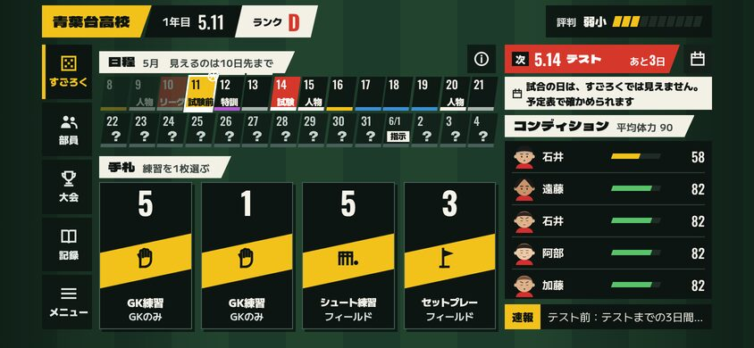 ホーム（10 日先まで・その先は「？」） | 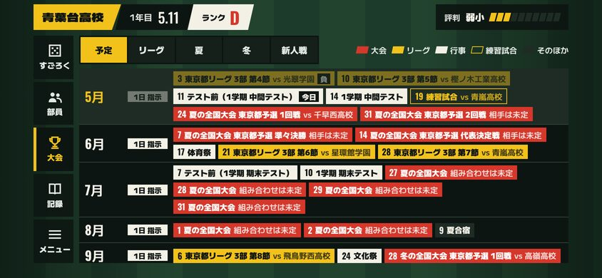 年間の予定表 |
| 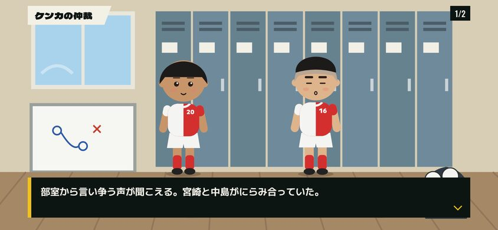 選択肢のあるイベント：始まり | 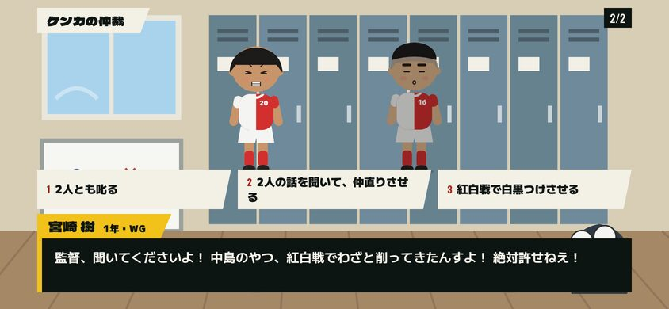 選択肢（せりふの枠の上に横並び） |
| 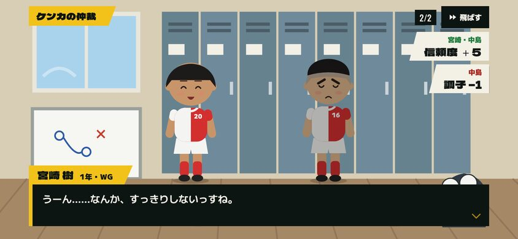 選んだ後の結果 | 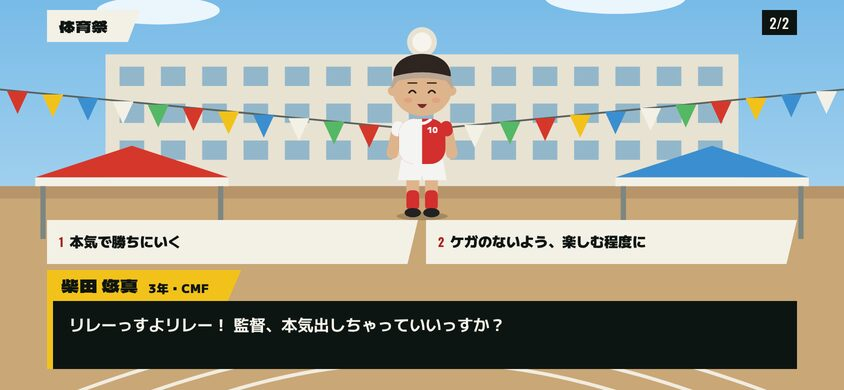 体育祭 |
| 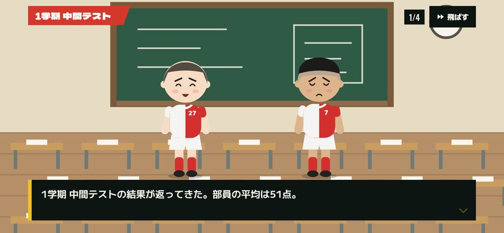 テストの結果（始まり） | 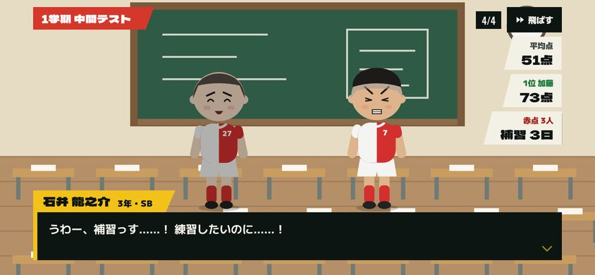 テストの結果（平均点・1 位・赤点と補習） |
| 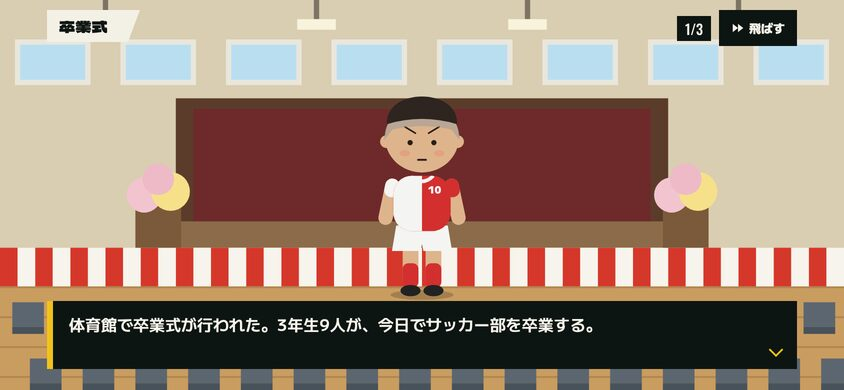 卒業式 | 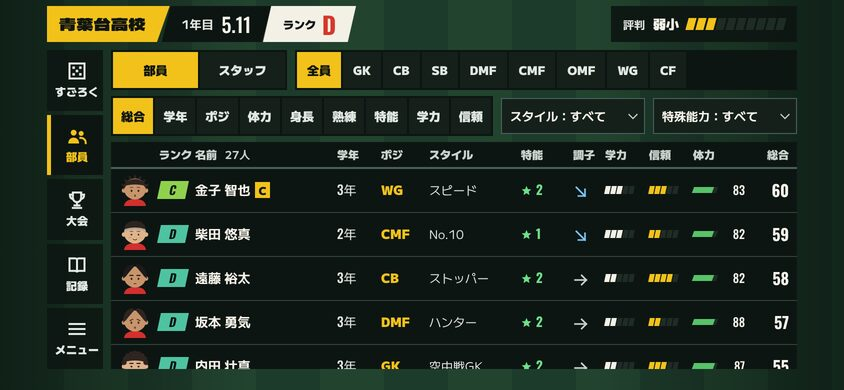 部員一覧（学力・信頼の列） |
| 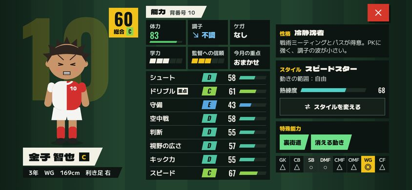 選手の詳細（学力・信頼・今月の重点） | 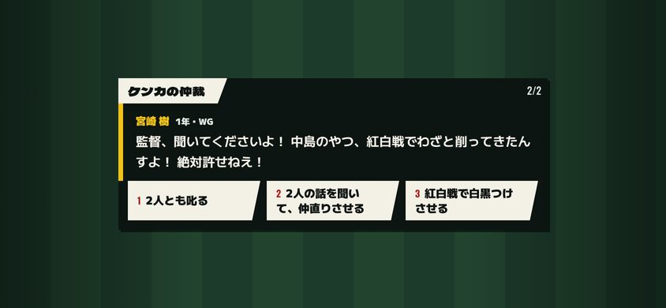 「文章だけ」の設定での選択肢 |
| 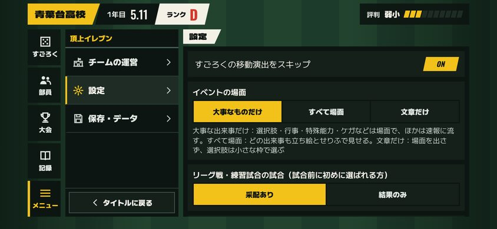 設定（場面の見せ方） | 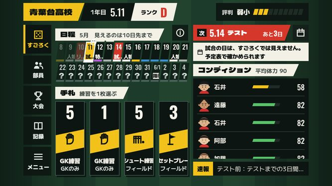 ホーム 667×375 |
| 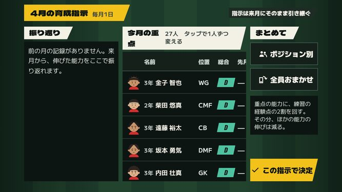 月初の指示 667×375 | 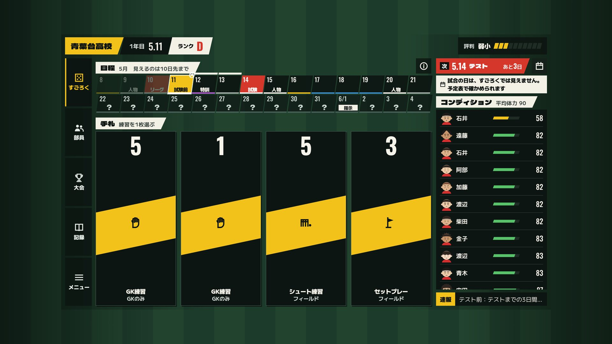 ホーム 1920×1080 |

---

## 3. 一年の進み方（自動プレイで数え直したもの。計画 7章）

`balance:full` の評判の推移（うまい采配の自動プレイ、72 校 × 20 年、月初の指示はおまかせ）で数えた 1 年あたりの回数。

| 判断（1 年あたり） | R1 | R2 の見込み | R2 の実測 |
|---|---|---|---|
| どのカードを使うか | 127 | 130 前後 | 135 |
| 月初の育成指示 | 0 | 12 | 12 |
| 選択肢のあるイベント（人物マス） | 0 | 14 前後 | 13.6 |
| 学校行事の選択（テスト前 5・体育祭・文化祭） | 0 | 7 | 7 |
| 試合の準備 | 25 前後 | 25 前後 | 25.8 |
| そのほか（スタッフ・キャプテン・合宿・分かれ道・スカウト） | 15 前後 | 15 前後 | 15.0 |
| **カード以外の判断** | **40 前後** | **73 前後** | **73.5** |

| 操作 | 回数 | 1 回の目安 | 合計 |
|---|---|---|---|
| カードを選んで進む | 135 | 3 秒 | 7 分 |
| 文章だけの出来事（速報） | 65 前後 | 1 秒 | 1 分 |
| 場面（選択肢なし。特殊能力・ケガ・OB の直伝・行事の結果など） | 20 前後 | 6 秒 | 2 分 |
| 選択肢のあるイベント・行事の選択 | 21 | 15 秒 | 5 分 |
| 月初の育成指示 | 12 | 5〜60 秒 | 1〜12 分 |
| 試合の前後（観戦を除く） | 26 | 30 秒 | 13 分 |
| そのほか | 15 | 20 秒 | 5 分 |
| **合計** | | | **34〜45 分** |

- 1 年に 355 日進み、1 人あたりの練習日は 257 日（テスト前の短い練習は 0.5 日で数える）。
- 人物マスのイベントは 26 種が起き、多いもの（ポジションの悩み・ケンカ・控えの悩み）で年 1 回、少ないもの（進路の相談・苦情）で 10 年に 1 回ほど。

---

## 4. 確かめたこと

| 確認 | 結果 |
|---|---|
| lint・typecheck | エラーなし |
| 単体テスト | 35 ファイル・238 件すべて通過（10 日の見え方・予定表、月初の指示と重点、テストと補習、行事、選択肢のイベントと信頼度、せりふ、セーブ v8 の移行を追加） |
| ビルド（静的書き出し） | 通過。最初の読み込みの JS（gzip）は 345KB（R1 の報告では 306KB。月初の指示・予定表・せりふ・行事の背景の分） |
| 画面の大きさ | 667×375・844×390・932×430・1024×768・1280×720・1920×1080 で、ホーム・月初の指示・1 人の指示・予定表・選択肢の場面・部員一覧・選手の詳細を撮り、画面からはみ出す要素がないことを自動で確認 |
| 古いセーブ | R1 のセーブ（v7）を、ふつうの日・夏の県予選の最中・観戦中の試合の 3 つで読み込み、1 年遊び続けられること（月初の指示 10 回以上・テスト・次の試合）をテストで確認。v2〜v6 の移行テストも通過 |
| 乱数 | せりふと場面の決まりは表示だけで乱数を使わない（同じ種なら、場面の設定を変えても結果は同じ） |
| `balance:full` | 72 校 × 20 年まで実行（34 分）。結果は 5章 |

---

## 5. バランス（`balance:full`）

| 項目 | R2 | R1 | 目標 | 判定 |
|---|---|---|---|---|
| 一般入部の卒業生の総合 B 以上 | 7% | 7〜8% | 5〜8% | OK |
| 金色を持って卒業する割合 | 3.9% | 4.1% | 2〜5% | OK |
| 名門に初めて届いた年 | 10 年目（99%） | 10 年目 | 10 年前後 | OK |
| 名門の年の自校のランク | 平均 A（3.56） | 平均 A（3.56） | 平均 A | OK |
| 全国優勝の経験：激戦区 | 29% | 29% | 30〜40% | NG（R1 と同じ） |
| 全国優勝の経験：普通 | **33%** | 50% | 45〜55% | **NG** |
| 全国優勝の経験：少数 | 54% | 50% | 55〜65% | NG（R1 より近い） |
| 全国優勝の経験（3 区分を合わせて） | 39% | 43% | — | — |
| テストの赤点の割合 | 6〜8% | — | 計画の想定（数%〜1 割） | OK |
| 年度末の学力の 5 段階（低い順） | 2・26・44・22・6% | — | 真ん中が多い | OK |
| 年度末の信頼度の 5 段階（低い順） | 0・13・61・24・1% | — | — | — |

月初の指示の 3 通り（12 校 × 10 年。一般入部の卒業生）：

| 指示 | 総合の平均 | 総合 B 以上 | 能力の偏り（一番高い能力 − 平均） |
|---|---|---|---|
| 重点なし | 57.9 | 2% | 10.0 |
| おまかせ（標準） | 60.1 | 4% | 13.7 |
| 自分で決める（ポジションで一番大事な能力 1 つ） | 60.3 | 6% | 25.6 |

- 重点の合計の経験点は変えていないので、重点はポジションに合った能力に寄せる分だけ総合が上がる。おまかせは偏りを抑え、自分で 1 つに絞ると偏りが大きくなる（その能力のランクは上がるが、ほかが伸びにくい）。
- **全国優勝の経験（普通 33%）**：R2 の作業の途中で 33%（3 区分合わせて）まで下がったので原因を調べた。自動プレイが学校行事のマスの前にも「試合の前」と同じように休んでいたのが一因で、直して 39% に戻った（R1 は 43%）。残りの差は、区分ごと 24 校ではぶれが大きく（同じ設定でも区分ごとに ±10 ポイント前後動く）、はっきりした原因は見つかっていない。試合前の体力・調子は R1 と同じで、成長の倍率を R1 に近づけても（総合 B 以上 12%）全国優勝は増えなかった。自県の上位校を少し弱める案も試したが、激戦区 21%・普通 42%・少数 58% で、はっきりした改善にはならなかったので入れていない。6章 Q1 で決めていただきたい。
- 以前からの NG（R1 と同じ）：パワープレイ（+2.9pt）、スタッフなしの総合 B 以上（4.2%。R1 は 3.6%）。

---

## 6. 計画からの変更・仮の部分

- **人物マスの割合**：計画は通常マスの 13% 前後だったが、それでは 1 年 11 回ほどしか起きなかったので **16%** にした（青・赤・白・緑・黄を少しずつ減らした）。1 年 13.6 回。SPEC の表も直した。
- **成長の倍率**：重点で総合が伸びやすくなった分、練習の経験点の倍率を 0.8 → **0.71** にした（行事で練習日が減った分を差し引いても、おまかせで総合 B 以上が 11% になったため）。
- **分かれ道の置き場所**：分岐の日は大マス（試合・行事など）と月の初日を避けて置き、道の途中に試合の日が入るのは許した（試合の日はすごろく上では隠すので、道の並びとして見せる）。試合の日を道に入れないと、分岐が 1 年に 2 回ほどしか置けなかったため。SPEC 5章に書いた。
- **入学式・卒業式**：計画どおり場面を足した。入学式はゲームの始めと毎年の年度末の後、卒業式は卒業の画面の前に出る。
- **「文章だけ」の設定**：選択肢のあるイベントだけは選ぶ必要があるので、場面の代わりに小さな枠（文章と選択肢）で出す（写真 14）。
- **試合の日のお知らせ**：1 年目の最初の 3 か月は、ホームに「試合の日は、すごろくでは見えません。予定表で確かめられます」の帯を出し、押すと予定表が開く（計画 14章の「初めの数回のお知らせ」）。
- **同じランクへの勝率**：計画 8章に「自動プレイで 50〜55%」と書いたが、今の `balance:full` の「ランク差 0」の勝率（全試合）は R1 の `balance:quick` で 34%、R2 の `balance:full` で 42% で、計画に書いた数字は別の数え方のものだった。R1 より下がっていないことで確かめた。
- **せりふ**：今のイベント 19 種などに足したせりふと、選択肢のイベントのせりふを合わせて 570 行ほど。すべて設定データにある。

---

## 7. 決めていただきたいこと

| # | 内容 | おすすめ |
|---|---|---|
| Q1 | **全国優勝の経験（普通の県 33%、目標 45〜55%）をどうするか**。3 区分を合わせると 39%（R1 は 43%） | **このまま進め、R3 の後にもう一度測る**。区分ごとのぶれが大きく、試した 2 つの直し方（成長を戻す・自県の上位校を弱める）でははっきり良くならなかった。R3 で試合の見せ方を作り直した後、区分ごとの学校を増やして（40 校ずつ）測り直し、まだ低ければそこで直す。ほかの案：R2 のうちに区分ごと 40 校で測り直して原因を探す（1 回 1 時間ほど） |
