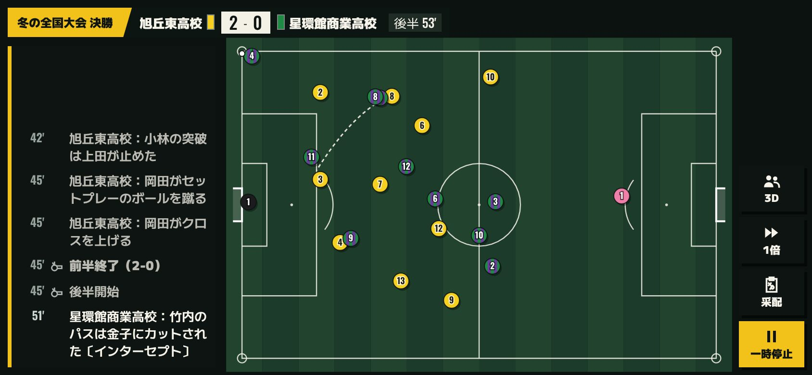
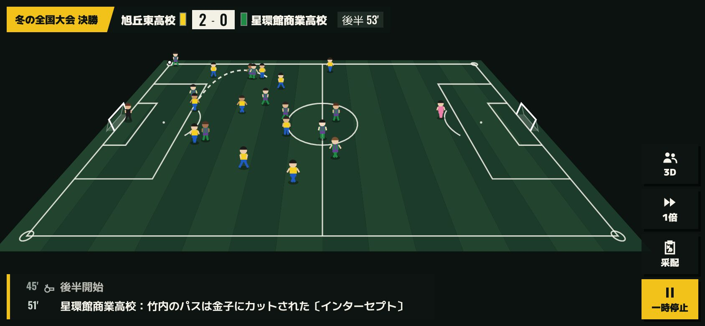
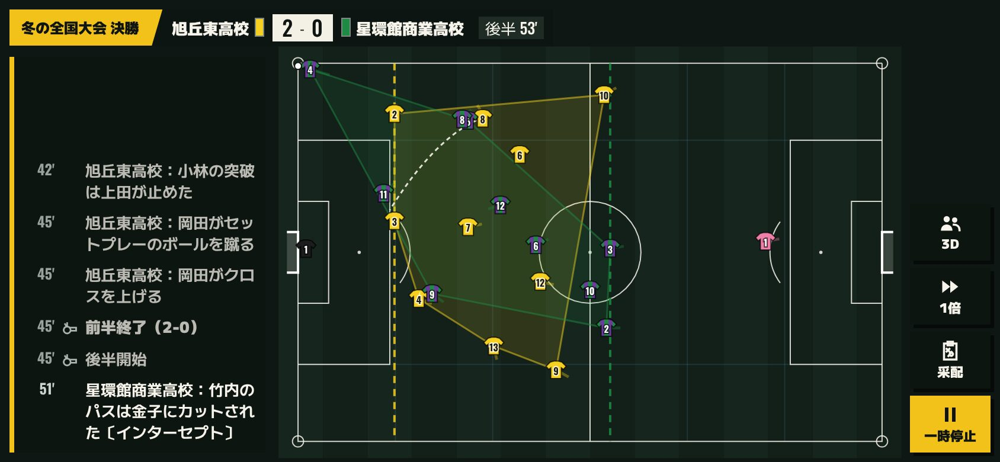
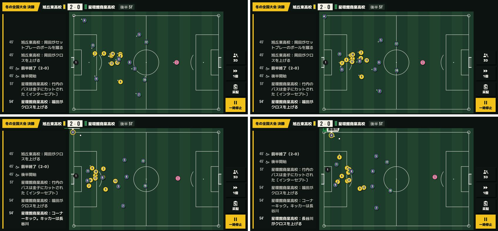
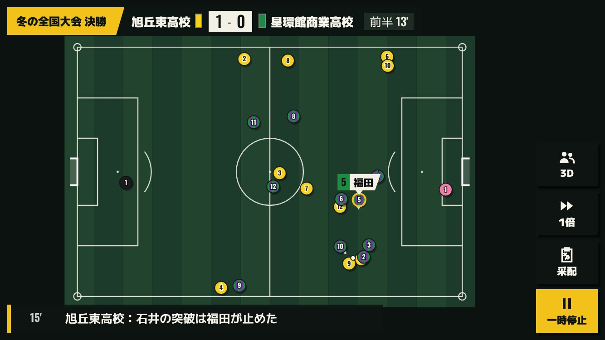
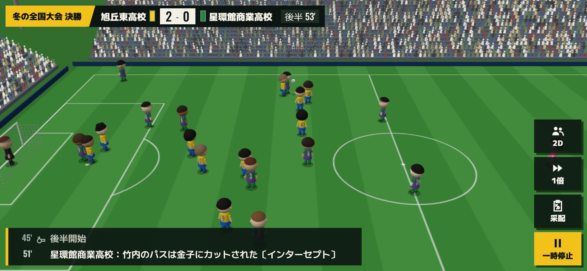
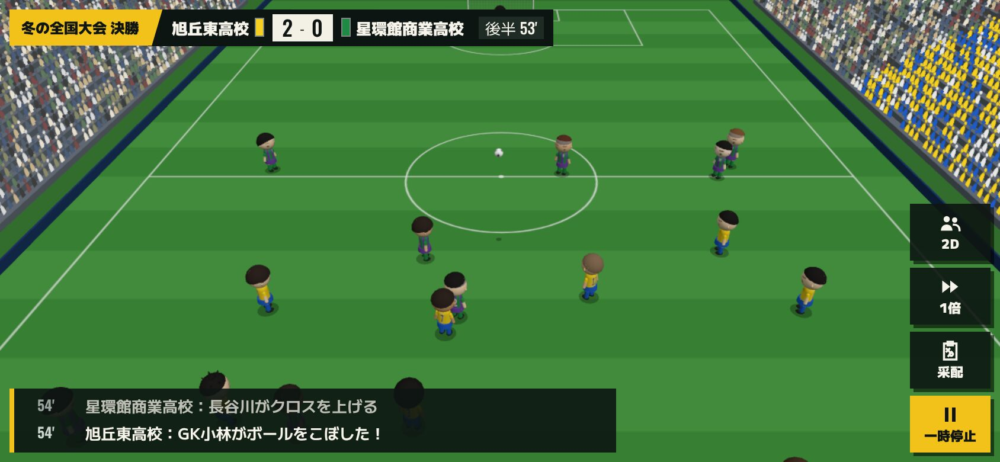
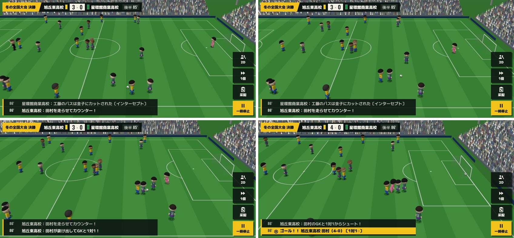

# Phase R3 計画：試合の見せ方の作り直し

- 依頼：`phaseR3-prompt.md`（2026-10-16）。小さな追加として「月初の指示の画面で、重点にしてからの累計の伸びを選手ごとに見せる」（2026-10-16 03:03 のご依頼）
- 正本の仕様：`docs/SPEC.md`（この計画に合わせて 10.1・10.8・13章・18.1 を書き換え、新しく 19章「試合の見せ方（PR3）」を足した。19章は承認までは「案」）
- 試作：`docs/phaseR3/proto/`（JPG。共有フォルダの `phaseR3/proto/` に元の大きさの PNG と短い動画）。844×390 で撮影
  - 試作は計画のためだけの仮のコードで、この PR には入れていない。動きの試作（約 820 行）・2D の描画（約 690 行）・3D のカメラと再生の差し替えで、本実装はこれを整理して `src/engine/replay/` と画面に作り直す
  - 試作に使った試合は `?demo3d=1` と同じデモの試合（冬の全国大会の決勝、90 分・146 件のイベント・4-0）
- **承認まで、ゲームのコードは変えない**（この PR は計画と SPEC・CLAUDE.md の更新だけ）

---

## 0. 今の見せ方と問題

今の 2D と 3D は、どちらも `src/engine/replay/` の演出タイムライン（`buildTimeline`・`frameAt`）を再生している。

| 今の作り | 問題 |
|---|---|
| 1 分の中のイベントを、その分の終わりの 0.85 分にまとめて詰める。イベントのないあいだは「後ろでパスを回す」だけ | イベントのない時間はボールがほとんど動かず、イベントのところだけ急に速く動く |
| 選手の位置は「陣形の位置 ＋ ボールへ少し引き寄せ」を毎フレーム計算するだけ | 速さの上限がないので、カウンターやロングボールで選手が瞬間移動に近い動きになる。チームの押し上げ・戻り、戦術・スタイルの違いが見えない |
| 動きの元は、その瞬間のボールの位置だけ | 試合の前後の流れ（マーク・裏への抜け出し・セットプレーの並び）がない。止まるプレー（スローイン・ゴールキックなど）がほとんど見えない |
| 2D は SVG を React で毎フレーム描き直す | 丸と背番号だけで、ボールの高さ・軌跡・ボールを持つ選手の名前がない。画面の 3 分の 1 を速報が占める |
| 3D のカメラはゴールの後ろの斜め上 | 中継の向き（タッチライン側）ではない（R1 報告書 Q2 で R3 に回したもの） |

もう 1 つ、エンジンの記録の足りないところがある。**試合中の体力と、途中で変えた戦術は記録されていない**（イベントには「戦術を変えた」という行だけがあり、何に変えたかがない。陣形と出ている選手は `shapes` に分ごとに残っている）。1.10 と Q3 でどうするかを決めていただきたい。

---

## 1. 動きの仕組み

### 1.1 全体の流れ

試合エンジンは 5 分（1 区間）ごとに計算し、その区間のイベントを 1 分単位で出す。表示は、計算が済んだ区間を再生していく。新しい演出は次の 4 段で作る。

1. **時刻の割り付け**：区間の中のイベントに、表示上の時刻（分の小数）を割り付ける（1.2）。
2. **ボールの道筋**：イベントとイベントのあいだを、表示だけのつなぎのプレー（パス・ドリブル・止まるプレー）で埋め、ボールの道筋を作る（1.3・1.11）。
3. **選手の動き**：0.025 分（等速で 0.1 秒）ごとに、全員の位置を「行きたい場所」へ、速さと加速の上限つきで動かす（1.4〜1.9）。
4. **再生**：2D・3D は、作った道筋と位置を時刻で引いて描くだけ（2章・3章）。

- **区間ごとに作る**：采配は次の区間から反映されるので、演出も区間ごとに、その区間までのイベントだけで作る。区間の終わりの全員の位置と速さを次の区間に引き継ぐ。**途中から作っても最初から通して作っても同じ動き**になる（テストで確かめる）。
- **専用の乱数**：試合の乱数は使わない。試合の ID（両校の学校 ID と大会・日付から作る文字列）から `Rng.fromSeed("replay:" + …)` で作る演出専用の乱数を、区間ごとにその区間の番号を混ぜて作り直す。だから同じ試合はいつ見ても同じ動きになり、区間の途中で読み込み直しても変わらない。
- **試合の結果は変わらない**：`src/engine/match/` の判定は変えない。試合の結果の指紋のテスト（`fingerprint.ts`）と `balance:quick`・`balance:full` の数値が、R2 と同じであることを確かめる。

### 1.2 時刻の割り付け

- 今は 1 分の中のイベントを分の終わりにまとめて詰めている。新しくは、**速報に出るイベントは、その分の中（m−1 分より後、m 分まで）**に、前のイベントからの移動にかかる時間を見込んで割り付ける。
  - 移動にかかる時間の目安：ボールの距離 ÷ パスの速さ（14m/秒）＋ 0.1 分。同じ選手が持ち運ぶならドリブルの速さ（6.5m/秒）で。
  - ゴールの後は 0.9 分（喜び → キックオフ）、外れたシュートの後は 0.35 分（ゴールキック）、セットプレーの前は 1.4 分（並ぶ時間）、ファウル・警告の後は 0.25 分を空ける。
  - 分の中に収まらないときは、イベントの場所（エンジンには細かい位置はなく、`lane`・`zone` から表示用に作る点）を、選手が間に合う所へ寄せる。
- 試作では区間の中で自由に前後させたため、速報の「15'」が時計の 13 分台に出ることがあった（`02_A_667.jpg`）。本実装では上の決まりで、**速報の分と時計の分がずれない**ようにする。時計は「経過中の分」（14 分台なら 15'）で出す。
- 前半・後半の終わり、延長、PK 戦の前は今と同じ時刻で区切る。

### 1.3 ボールの道筋（表示だけのつなぎのプレー）

- 次のイベントまで時間が余るときは、ボールを持っているチームが**つなぎのプレー**をする。速報には出さず、記録もしない。
  - 空いている味方へのパス（近い・前向き・相手から離れている味方を選ぶ。ビルドアップ重視は短く、ロングボール主体は後ろから前線への長いボールを混ぜる）、ドリブルで運ぶ、少し持って周りを見る。
  - 必ず「つなぎのパス ＋ 次のイベントへの最後の 1 本」が次のイベントの時刻までに間に合うときだけ出す。間に合わないなら、次のイベントの選手へ向かって運ぶ。
- ボールの動きの種類：転がるパス・浮き球（クロス・ロングボール）・シュート・ドリブル・持つ・止まった球（セットプレーの前）。浮き球は放物線の高さを持ち、**2D では影と大きさで高さを見せる**（ボールは高いほど大きく、影は離れて小さく）。
- イベントの時刻には、**ボールがイベントの場所に、イベントの選手がボールのそばにいる**（テストで確かめる。1.14）。

### 1.4 イベントの選手の「約束」

- 次のイベント（セットプレーは 3 分先まで、それ以外は 12 件先まで）を先読みして、その選手と、競り合う相手（守備側の選手・GK）に「この時刻にこの場所」という約束を付ける。
- 約束のある選手は、間に合うように早めに動き出す（カウンターで FW が前へ走り出す、クロスにゴール前へ入る、など）。約束がなければ、1.6〜1.9 の立ち位置へ動く。

### 1.5 速さ・加速・重ならない

- **速さの上限**：スピードの能力から 6.0〜8.8m/秒（`6.0 + 2.8 × スピード / 100`）。疲れで最大 28% 落ちる（1.10）。加速も上限つきで、**瞬間移動はしない**。
- 時間の換算は今の観戦の時間（等速で試合の 1 分＝現実の 4 秒）に合わせ、走る速さは現実の秒で本物の選手に近い速さにする（2 倍・4 倍のときは、全体がそのまま速く見える）。
- **重ならない**：選手どうしは 2.6m（背番号が重ならない距離）より近づかないよう押し合う。ボールを競り合う 2 人だけは 1.4m まで近づける。
- ピッチの外には出ない（交代で出入りする選手、退場する選手、スローインの選手はタッチラインの外まで）。

### 1.6 チームの形と戦術

- **基本の位置**：フォーメーションの位置（`config/formations.ts`）。ボールの縦の位置に合わせて全体が上下し、ボールのある側へ寄る（守るときは横に狭く、攻めるときは横に広く）。
- **攻守**：攻めるときは押し上げて縦にも広がり、守るときは下がって縦に縮む。
- **切り替え**：ボールを奪ったチームは前へ、失ったチームは自陣へ戻る。エンジンの「カウンター」のイベントでは、FW と速い選手が一気に前へ走る。

| 戦術 | 見え方 |
|---|---|
| ライン 高／低 | 最終ラインと全体の高さ（高は相手陣に近く、低は自陣のペナルティエリアの近くまで下がる） |
| プレス 高／中／低 | ボールに寄せる人数（高は 2 人、中は 1 人、低は自陣に入るまで寄せない）。ボールハンターは近ければプレスに加わる |
| 攻撃方針 攻撃的／バランス／守備的 | 攻めるときに前へ出る人数（攻撃的はサイドバックや中盤も上がり、守備的は後ろに多く残る）と全体の高さ |
| 組み立て ビルドアップ／ロングボール | つなぎのプレーの種類（ビルドアップは短いパスが多く GK からもつなぐ。ロングボールは後ろから前線へ長いボール、前線は相手の最終ラインの近くで待つ） |

- **フォーメーションの変更・交代・10 人**：`shapes`（分ごとの陣形と出ている選手）を引き、その区間の陣形の位置を使う。退場で 10 人になったら、その時点の陣形の空いた位置を詰めて使う（エンジンと同じ考え）。交代で出る選手はベンチ側のタッチラインへ歩いて出て、入る選手はそこから入る。

### 1.7 スタイルごとの動き

SPEC 7.6 の「動きの範囲」（自由・定位置・主に大外・主に内側・大外のみ）で、ボールの側へ寄る強さを変える（自由 1.0、主に内側 0.8、主に大外 0.6、定位置 0.4、大外のみ 0.35）。その上に、スタイルごとの動きを足す。

| スタイル | 攻めるとき | 守るとき |
|---|---|---|
| ストライカー | 相手の最終ラインの少し手前で、ゴール前へ入るタイミングを待つ | 前線に残る |
| ポストプレーヤー | 中央で相手を背にして受ける位置（定位置） | 前線に残る |
| スピードスター | 相手の最終ラインに並び、ときどき裏へ走る | 前線に残る（カウンターに備える） |
| リンクマン | FW の少し下がった位置で、中盤とつなぐ | 少し下がって中盤を助ける |
| ポーチャー | 敵陣ではペナルティエリアの中に居続ける。組み立てに加わらない | 前線に残る |
| ウイングドリブラー | 大外のタッチライン近くに張る | ふつう |
| インサイドドリブラー | 内側（サイドとゴールのあいだ）に入る | ふつう |
| No.10 | 相手の中盤と最終ラインのあいだで受ける | ふつう |
| ボックストゥボックス | 前へ出てゴール前まで上がる | 深く戻る（上下に一番よく走る） |
| アンカー | 中盤の底に残り、中央から動かない | 最終ラインの前を中央で固める |
| ボールハンター | ふつう | 近くのボールに自分から寄せる（プレスの人数に足す） |
| クロッサー | 大外に張る | ふつう |
| ストッパー | ふつう | 相手の FW に体を寄せてマークする |
| カバーリング | ふつう | 最終ラインの少し後ろで裏をカバーする |
| 攻撃的サイドバック | 敵陣に入ったら大外を駆け上がる（オーバーラップ） | 戻る |
| ビルドアップ型 | 後ろで受けて前を向く位置へ開く | ふつう |
| 砲台 | 後ろに残る（定位置）。つなぎのプレーで前線への長いボールを蹴る | ふつう |
| ボックスキーパー | ゴールの近くに残る | 同じ |
| スイーパーキーパー | 最終ラインの裏まで出る（ふつうより 6m 前） | 同じ |
| 空中戦の番人 | ふつうの位置。クロスのときにゴール前に構える | 同じ |

- 定位置のスタイルは持ち場から大きく離れない。どのスタイルもないとき（スタイルを持たない選手・CPU）は、ポジションのふつうの動き。
- **ボールを持った選手の動き**：ドリブルのスタイルはつなぎのプレーで運ぶことが多く、パスのスタイルはパスが多い（表示だけ）。

### 1.8 守備

- **マーク**：自分の持ち場に近い相手の選手の、ゴール側に立つ。
- **パスのコースを切る**：ボールを持つ選手と近くの相手のあいだに入る。
- **プレス**：プレスの人数（1.6）だけ、ボールに近い選手がボールへ寄せる。
- **最終ライン**：DF は横一列にそろえる（いちばん下がった DF に合わせる）。

### 1.9 GK

- ゴールとボールを結ぶ線の上に立つ。ボールが近いほどゴールに近く、遠いほど前へ出る（スイーパーキーパーはさらに前）。
- セービング・キャッチ・飛び出しのイベントでは、約束（1.4）でボールの所へ動く。

### 1.10 疲れ

- 疲れた選手は、速さの上限が下がり（最大 28%）、立ち位置へ戻る動きも小さくなる（ボールへ寄る・上がる動きを最大 30% 減らす）。
- **ただし、試合中の体力は記録されていない**（試合の最後の状態だけが残る）。やり方は 2 つ。
  - **案 A（おすすめ）：記録だけを足す**。エンジンの区間の終わりに、両チームの戦術と、出ている選手の体力（整数）を 1 行ずつ記録する。乱数も判定も変えない（P3 の `lane`・`zone` と同じ扱い。SPEC 10.8 の決まりのとおり）。試合の結果の指紋が変わらないことをテストで確かめる。途中で変えた戦術も、この記録から正しく見せられる。
  - **案 B：推定する**。経過時間と体力の能力・プレスの設定から、表示のためだけに見積もる。エンジンは変えないが、途中で変えた戦術は分からない（試合の終わりの戦術で通して見せることになる）。
- 記録はセーブの試合の途中の状態に入る（1 試合で数 KB 以下）。記録のない古い途中の試合は、案 B の推定で見せる。

### 1.11 止まるプレーとセットプレー

エンジンにない再開は、今と同じく表示だけで足し、速報には出さない（P4 で決めたこと）。

| 場面 | 見せ方 |
|---|---|
| キックオフ | 前半・後半・延長の始めと、ゴールの後。両チームが自陣に並び直してから蹴る |
| ゴール | ゴール → 喜び（得点者に味方が寄る）→ 自陣へ戻る → キックオフ |
| ゴールキック | 外れたシュートの後。GK がゴールエリアに置いて蹴る。両チームは少し下がる |
| スローイン | 大きく外れたクリアやパスの後。投げる選手がタッチラインの外へ |
| コーナーキック | 蹴る選手がコーナーへ走る。攻める側は背の高い選手からゴール前へ、守る側はゴール前を固め、GK はゴールの中央 |
| フリーキック | ファウルの場所に置き、守る側は壁（2〜4 人）を作る |
| PK（試合中） | キッカーと GK 以外はペナルティエリアの外 |
| こぼれ球 | いちばん近い選手が取りに行く |

- 止まっているあいだも、**選手は瞬間移動しない**（並び直す時間を 1.2 の割り付けで空ける）。すばやく置き直すのはボールだけ（ボールボーイが渡す扱い）。

### 1.12 延長・PK 戦・ケガ

- 延長は前半・後半と同じ。PK 戦は今の見せ方のまま（3D は今の PK 戦の視点。2D は今の PK の表示を新しい見た目に合わせる）。
- ケガで交代する選手は、倒れた場所からベンチ側へ歩いて出る（4b の動きは使わない）。

### 1.13 重さとデータの大きさ

- 試作では、1 試合を通して作るのに約 0.5〜0.66 秒（パソコン）。CPU を 4 倍遅くした条件で 1.3〜1.6 秒。区間（5 分）あたり約 30ms（4 倍遅くて約 90ms）。
- 本実装では、**区間ごとに作り、フレームのあいだに少しずつ進める**（1 フレームで 8ms 以内に区切る）。区間を観戦の再生が追いつく前に作り終えるので、止まって見えることはない。
- 作った動きは、0.025 分ごとの全員の位置（22 人 × 2 値 × 4 バイト）で、区間あたり約 35KB、1 試合で約 650KB。メモリに置くだけで、セーブには入れない（同じ乱数から作り直せるので）。

### 1.14 試作の結果（デモの試合）

| 項目 | 結果 |
|---|---|
| ボールのイベント（134 件）のうち、場所と時刻どおりに起きた数 | 132 件（残り 2 件は約束が重なって間に合わなかった。本実装では寄せ（1.2）で 0 件にする） |
| イベントの時刻の、イベントの選手とボールの距離 | 中央値 1.4m、90% が 5.4m 以内（本実装の目標は全件 2m 以内） |
| セットプレーで蹴る選手とボールの距離 | 約 1.4m |
| 速さの上限を超えた回数 | 0 回（上限との比の最大が 1.000） |
| 1 試合を通して作る時間 | 0.5〜0.66 秒（パソコン） |

---

## 2. 2D の見た目

### 2.1 共通（どの案でも作るもの）

- **描き方を変える**：SVG と React の描き直しをやめ、`canvas` に毎フレーム直接描く（`requestAnimationFrame`）。React はスコアボード・速報・ボタンだけを描く。
- **ピッチ**：本物の比率（105m × 68m）の正しいライン（センターサークル・ペナルティエリア・ゴールエリア・ペナルティアーク・コーナーアーク・ゴール）。横画面いっぱいに広げ、芝の刈り込みの縞を入れる。
- **選手**：ユニフォームの色と柄（17章の型：無地・縦縞・横縞・たすき・半分など）と背番号。GK は GK のユニフォーム。
- **ボールを持つ選手の名前**：中継のテロップの形で、選手の上に背番号と名前を出す。
- **軌跡**：パスは点線、シュートは太い線、浮き球は弧。少しずつ消える。
- **大事な場面の短い演出**：ゴール（「ゴール」の帯が横切る）、決定機・セーブ・カードで、0.6〜1 秒の小さな光や帯。
- **667×375（小さめのスマホ）で読める**：背番号は 10px 以上、名前のテロップは 12px 以上。滑らかさは 2.6 の重さで確かめる。

### 2.2 3 つの案

| 案 | 見た目 | 試作 |
|---|---|---|
| **A：中継のグラフィック（真上）** | 真上から見たピッチに、柄の入った丸と背番号。ボールを持つ選手にテロップ | `01_2d_A.jpg`・`seq_A_*.jpg`・`r3_2d_A_counter.mp4` |
| **B：斜めの見下ろし（小さな人）** | 手前が大きく奥が小さい斜めの見下ろしに、2.5 頭身の小さな人（ユニフォームの色・柄） | `01_2d_B.jpg`・`seq_B_*.jpg`・`r3_2d_B_counter.mp4` |
| **C：作戦ボード（真上）** | 真上から見たピッチに、シャツの形の印と背番号。チームの広がり（外側を結んだ形）と、最終ラインの点線、動きの尾 | `01_2d_C.jpg`・`seq_C_*.jpg`・`r3_2d_C_counter.mp4` |

連続の写真（4 枚で 1 組）は、それぞれ次の場面。`nor`＝ふつうの攻め、`cnt`＝カウンター、`ck`＝コーナーキック。ゴールの場面は動画の終わりに入っている。

コーナーキックの連続（A）：蹴る選手がコーナーへ走り、両チームがゴール前に集まり、クロスが上がる。

### 2.3 くらべ

| | A：中継のグラフィック | B：斜めの見下ろし | C：作戦ボード |
|---|---|---|---|
| 動きの分かりやすさ | 良い | 良い（3D に近い） | とても良い（形と線が見える） |
| 背番号・名前の読みやすさ | 良い | 奥の選手の背番号は読めない | 良い |
| 667×375 での見やすさ | 良い | 奥が小さくなり、少し窮屈 | 良い（線が多く、少しにぎやか） |
| 3D との違い | 大きい（2D らしい） | 小さい（3D の軽い版に見える） | 大きい |
| 重さ（1 フレームを描く時間。2.6） | 0.61ms | 0.63ms | 1.23ms |

### 2.4 おすすめ

**A を基本にする**。いちばん読みやすく、軽く、667×375 でも窮屈にならない。

- C のチームの広がりと最終ラインの線は、**一時停止中とハーフタイムだけ**重ねて見せる（采配を考えるとき、陣形と押し込まれ方が分かるように）。
- B は見た目は魅力があるが、奥の選手の背番号が読めず、2D を選ぶ理由（軽さ・見やすさ）とずれるので、今回は作らない。

### 2.5 試合の画面の配置

- **ピッチを画面いっぱい**にし、スコアボード（左上）・速報・ボタン（右）を重ねる。
- **広い画面**（幅 760px 以上）：速報は左の列に数行（`01_2d_A.jpg`）。
- **狭い画面**（667×375 など）：速報は下に 1 行だけ重ね、ピッチをできるだけ大きく（`02_A_667.jpg`）。
- ボタン（3D／2D の切り替え・倍速・采配・一時停止）は今の右の列のまま。テキストのみの表示は今のまま。
- ハーフタイム・PK 戦・試合後の画面は今のまま（見た目だけ合わせる）。

### 2.6 どこで使うか

今と同じ。リーグ戦・練習試合の「采配あり」と、トーナメントで 3D を切っているとき（設定の「2D＋速報」・WebGL のない端末・3D の読み込みの失敗）。

---

## 3. 3D の中継の向きのカメラ

### 3.1 カメラ

- **タッチライン側の斜め上**から、ピッチを横向きに見る（中継の向き）。**自校が右へ攻める向き**になるように、カメラを置く側を決める（今の表示はハーフタイムで陣地を替えないので、試合を通して自校が右へ攻める。2D も同じ向きにそろえる）。
- 画角 30°、見下ろす角度 27°。
- **ボールを横に追う**：カメラの見る点は、ピッチの長さの方向はボールに合わせ（両端は 18m 手前で止める）、幅の方向はボールの 35% だけ動く。
- **ゴール前で少し寄る**：場面の種類で距離を変える（ふつう 74m、広く 84m、近く 60m、ペナルティエリア 64m、コーナー 64m、ゴール 52m）。距離は滑らかに変わる。
- **PK 戦は今の視点のまま**（キッカーの後ろからゴールを見る）。

連続の写真（`seq_3d_nor.jpg`・`seq_3d_cnt.jpg`・`seq_3d_ck.jpg`）と動画（`r3_3d_counter.mp4`）。

### 3.2 3D で変えるもの

- 選手とボールは、1章の新しい動き（2D と同じ）で動かす。今のばねで寄せる動きはやめ、位置はそのまま使う（向きと手足の動きだけを 3D 側で滑らかにする）。
- 歩く・走るは、新しい動きの速さで選ぶので、今より自然になる（脚の振りは進んだ距離に合わせる）。
- ボールの高さは、新しい道筋の高さを使う。
- **自校の応援席**（旗と横断幕）を、カメラの向かい側（画面の奥）に移す。今はカメラの後ろ側になって見えない。

### 3.3 重さ

中継の向きは、奥の観客席が画面の上半分に大きく入るので、今のカメラより描くものが増える（3.4 の数値）。重い端末向けには、軽量の画質で奥の観客を減らす（今の `crowdDensity` の考えのまま）。

### 3.4 試作で測った数値（ソフトウェアの描画なので fps は参考にならない）

| | 描く回数（1 フレーム） | 三角形の数 | 動きの計算 | 描く命令を出す時間 |
|---|---|---|---|---|
| 新しいカメラ | 127 | 5.07 万 | 1.1ms | 3.5ms |
| 今のカメラ | 79 | 3.61 万 | 1.0ms | 2.6ms |

CPU を 4 倍遅くした条件（新しいカメラ）：動きの計算 10.8ms、描く命令 19.1ms で、約 30fps。実機の GPU の重さは、この環境では測れない。

---

## 4. 月初の指示：重点にしてからの累計の伸び

### 4.1 見せ方

- **一覧**（月初の指示の画面の「重点」の列）：能力名の横に小さく「5か月 +6」。
- **1 人の指示の画面**：「スピード：重点にして5か月、＋6」の形で、重点の能力ごとに 1 行。
- 重点にしたばかり（今月から）は「今月から」と出す。

### 4.2 数え方

- 選手ごと・能力ごとに、「重点にした月」と「そのときの能力の値」を覚える。今の値との差が「累計の伸び」、月の数が「重点にして何か月」。
- 重点から外したら、その能力の記録は消す（また重点にしたら 0 から数え直す）。
- 「指示」と「おまかせ」を切り替えても、同じ能力が重点のままなら数え続ける（Q6）。
- 記録は**表示のためだけ**で、成長の計算にも試合にも使わない。乱数も使わない。

### 4.3 セーブ（v8 → v9）

- 選手に表示用の記録（能力ごとの「始めた月」と「始めたときの値」）を足す。セーブのバージョンを 9 に上げ、移行の関数を足す。
- 古いセーブは、移行した後の最初の月初から数え始める（それより前の分は分からないので、遡らない）。
- 1.10 の案 A を選んだ場合、試合の途中の状態に足す記録も同じ v9 に入れる（古い途中の試合は記録なしとして扱う）。

---

## 5. 重さの見込みと測り方

### 5.1 目標

- **2D**：中くらいのスマホで 60fps、遅いスマホで 30fps 以上。1 フレームの描く時間は 4ms 以内（CPU 4 倍遅い条件）。
- **3D**：今の目標（中くらいのスマホで 30fps 前後。標準で最初の 10 秒が 24fps 未満なら自動で軽量にする）を変えない。
- **動きを作る時間**：1 フレームで 8ms 以内に区切り、再生が待たされない。

### 5.2 試作で測った 2D の重さ（844×390・ブラウザの自動操作）

| 案 | 1 フレームを描く時間 | CPU 4 倍遅い条件 |
|---|---|---|
| A | 0.61ms | 3.1ms（38fps。この環境では画面の合成が遅いため 60fps に届かない） |
| B | 0.63ms | 4.2ms（35fps） |
| C | 1.23ms | 6.6ms（31fps） |

ふつうの条件では、3 案とも 60fps。

### 5.3 測り方

- `?perf=1`（今ある 3D の計測）を 2D にも広げ、fps・1 フレームの時間・動きを作る時間を画面の隅に出す。
- 開発用の入り口 **`?demo2d=1`** を足す（`?demo3d=1` と同じデモの試合を 2D で見る）。
- 報告では、ブラウザの CPU を 4 倍遅くした条件で、2D と 3D の fps と 1 フレームの時間を出す。

### 5.4 4b を待っている実機の数値について

4b は、`/?perf=1` の実機の数値をいただくのを待って止めている。R3 の 3D は、カメラが変わって描くものが少し増えるので、**R3 を入れた後のプレビューで実機の数値をいただくほうが、4b の判断に役立つ**（Q5）。R3 の実装そのものは、実機の数値がなくても進められる。

---

## 6. テスト

- **イベントの場所**：すべてのボールのイベントの時刻に、ボールがイベントの場所にあり、イベントの選手がボールから 2m 以内にいる。
- **ピッチの中**：交代・退場・スローインのとき以外、全員がピッチの中にいる。
- **速さの上限**：どの選手も、どの時刻でも速さと加速の上限を超えない。
- **重ならない**：競り合い以外で 2 人の距離が決めた値（少しの余裕を見て 2.0m）より近くならない割合を測り、上限を決める。
- **同じ動き**：同じ試合は何度作っても同じ。区間ごとに作っても通して作っても同じ。
- **いろいろな試合**：延長・PK 戦・退場・ケガ・交代・フォーメーションの変更のある試合で、最後まで作れる（多数の試合で試す）。
- **時刻**：速報に出るイベントは、その分の中に割り付けられる。
- **月初の累計の伸び**：重点にした月・外した月・おまかせとの切り替え・年度の替わり目、v8 → v9 の移行。
- **結果が変わらない**：試合の結果の指紋が R2 と同じ。`balance:quick` と `balance:full` が R2 と同じ（PR の前に `balance:full`）。

---

## 7. 作業の順番（承認していただいた後）

1. （Q3 で案 A なら）エンジンに記録だけを足す（区間ごとの戦術と体力）。指紋のテスト。セーブ v9 と移行。
2. 新しい演出（`src/engine/replay/`）：時刻の割り付け、ボールの道筋、約束、移動（速さ・加速・重ならない）とテスト。
3. チームの形・戦術・スタイル・守備・GK・疲れとテスト。
4. 止まるプレーとセットプレー、交代・退場・延長・PK 戦とテスト。
5. 2D（canvas・A の見た目・テロップ・軌跡・ボールの高さ・演出）、試合の画面の配置、`?demo2d=1`、`?perf=1` の 2D。
6. 3D（中継の向きのカメラ・新しい動きの再生・応援席の位置）。PK 戦の視点は今のまま。
7. 月初の指示の累計の伸び（記録・画面）。
8. 重さの計測、連続の写真と動画（ふつうの攻め・カウンター・コーナー・ゴール、2D と 3D）、`balance:full`、報告書（`docs/PHASE_R3_REPORT.md`）。Vercel のプレビューで確かめる。

途中で一度、2 と 5 ができたところで 2D の動画をお見せし、待たずに続ける。

---

## 8. 作らないもの

- 4b：残りのモーション（ドリブルの技・倒れる・喜ぶなどの細かい動き）、ゴールの演出、PK 戦の 3D、天候・ナイター、観客の動き。ただし、歩く・走るは自然に見えるようにする。
- 試合エンジンの判定の変更（1.10 の記録を足すことだけ。結果と乱数の使い方は変えない）。
- 2D の B 案（斜めの見下ろし）。
- Phase 5 の内容。

---

## 9. 気になる点

- **イベントの場所を寄せること**：エンジンにはイベントの細かい位置がなく、今も `lane`・`zone` から表示用の点を作っている。間に合わないときに点を寄せても、ゾーン（左・中央・右、自陣・敵陣など）は変えない。
- **つなぎのプレーの多さ**：速報に出ないパスが増えるので、「速報にないプレーが多い」と感じるかもしれない。それが「選手が常に動いている」見え方なので、このまま進め、動画で見ていただく。
- **演出のための記録（案 A）**：エンジンのファイルに記録の行を足すことになる。判定と乱数は変えず、指紋のテストで確かめる。
- **3D の重さ**：奥の観客席が大きく入る。軽量の画質で奥の観客を減らす。実機の数値は R3 のプレビューでいただきたい（Q5）。

---

## 10. 決めていただきたいこと

| # | 決めていただきたいこと | おすすめ |
|---|---|---|
| Q1 | 2D の見た目 | **A（中継のグラフィック）**を基本にし、C のチームの広がりと最終ラインの線は一時停止中とハーフタイムだけ重ねる。B は作らない（2.4） |
| Q2 | 試合の画面の配置 | ピッチを画面いっぱいにし、速報は広い画面で左の列、狭い画面（667×375 など）で下に 1 行。ボタンは今の右の列（2.5） |
| Q3 | 疲れと途中で変えた戦術の見せ方 | **案 A：エンジンに記録だけを足す**（区間ごとの戦術と体力。判定と乱数は変えず、指紋のテストで確かめる）（1.10） |
| Q4 | 速報の分と動きの時刻 | 速報に出るイベントは、その分の中に割り付ける。間に合わないときはイベントの表示上の場所を寄せる。時計は経過中の分で出す（1.2） |
| Q5 | 4b の実機の数値 | R3 を入れた後のプレビューで `/?perf=1` を測っていただく（3D の描くものが少し増えるため）。R3 の実装は待たずに進める（5.4） |
| Q6 | 月初の累計の伸びの数え方 | **おまかせも数える**。指示とおまかせを切り替えても、同じ能力が重点のままなら数え続ける。重点から外したらその能力は消す（4.2） |
| Q7 | 自校の応援席 | 3D のカメラの向かい側（画面の奥）に移す（3.2） |
| Q8 | 途中経過の確認 | 動きと 2D ができたところで一度 2D の動画をお見せし、待たずに続ける（7章） |
