# Phase R3 報告：試合の見せ方の作り直し

計画は `docs/PHASE_R3_PLAN.md`（2026-10-16 承認。Q1〜Q8 はすべておすすめどおり。試作の動画を見ての 5 つの修正つき）。
画面写真は `docs/phaseR3/final/`（共有フォルダの `phaseR3/final/` に元の大きさの PNG と、場面ごとの短い動画 `2d_*.mp4`・`3d_*.mp4`）。

---

## 1. まとめ

| 項目 | 結果 |
|---|---|
| 動き（2D・3D 共通） | `src/engine/replay/` を作り直した。イベントの時刻を分の中に割り付け（`schedule.ts`）、キーとキーのあいだを表示だけのつなぎのプレーで埋め、22 人とボールを 0.1 秒（等速）ごとに速さ・加速の上限つきで動かす（`sim.ts`）。3D の手足の動き（キック・トラップ・GK など）は、動きの記録から台本を作る（`motion.ts`）。試合エンジンの判定・乱数は変えていない |
| 2D | canvas に毎フレーム描く A 案（中継のグラフィック）。柄の入った丸と背番号、ボールを持つ選手のテロップ、パスは点線・浮き球は弧・シュートは太い線の跡、ゴールの帯と決定機・セーブ・カードの小さな札。一時停止中とハーフタイムはチームの広がりと最終ライン |
| 試合の画面（2D） | ピッチを画面いっぱいにし、左上にスコアボード、右の端にボタン。速報は幅 760px 以上で左の列、狭い画面で下に 1 行。テキストだけの表示は今のまま |
| 3D | 中継の向きのカメラ（タッチラインの斜め上、画角 30°・見下ろし 27°）。自校が右へ攻める。PK 戦は今の視点。自校の応援席・片側だけのスタンド・屋根はカメラの向かい側 |
| 速報・スコア | ボールが関わるイベントは、動きの中で起きた時刻に出す（ボールがゴールに入ってから点が入る）。時計は経過中の分（14 分台なら 15'）。テキストだけの表示も同じ時刻 |
| 月初の指示 | 一覧の「重点」に「6か月 +11」「今月から」、1 人の指示に「判断：重点にして6か月、＋11」。おまかせも数え、指示とおまかせを切り替えても同じ能力が重点のままなら数え続ける。重点から外すと消える。セーブ v8 → v9 |
| 開発用 | `?demo2d=1`（`?demo3d=1` と同じデモの試合を 2D で。設定の画面でも 3D／2D を選べる）。`?perf=1` を 2D にも広げた。デモに `&go=1`（すぐ始める）・`&t=分`・`&pause=1` |
| バランス | 試合の結果の指紋（d71781a）と `balance:quick`・`balance:full` は R2 と同じ（5章） |

---

## 2. 承認のときの 5 つの修正

| 修正 | 対応 | 確かめ方 |
|---|---|---|
| 1. 切り替えを見て分かる強さに | ボールを奪った側は、持つ選手のほかに 2 人（カウンターは 3 人）が、相手の最終ラインの近くまで全力で前へ走って追い越す。奪われた側は、ボールの近く（38m 以内）とボールより前にいる選手が、全力で自陣へ戻る。試作でセンターサークル付近に残っていた選手が止まっていた原因（ゴールの後のキックオフの並びが 1.5 分残っていた）も直した | テスト：カウンターの 85% 以上で、奪った側の 2 人以上が 6m 以上前へ走り、奪われた側の近くの選手が自陣へ戻る（16 試合で 87%・92%）。写真 3 章の 86 分の場面 |
| 2. 味方どうしの丸が重ならない（2D） | 味方どうしは 3.6m 以上離す（2D の丸の半径は 1.65m）。動かすたびに必ず押し離し、ピッチの外にも出さない | テスト（必ず満たす条件）：16 試合のすべての歩と、そのあいだのコマで、味方どうしの間隔が丸の直径（3.3m）以上。いちばん近づいたのは 3.56m |
| 3. 3D で塊に見えない | キャラクターを実寸の 1.6 倍 → 1.3 倍にした（2D には関わらない）。ゴールは 1.45 倍 → 1.2 倍（選手の大きさに合わせる）。味方どうしの間隔は 2 と同じ 3.6m 以上 | 写真 3 章のコーナーキック・カウンター |
| 4. 2D のボールを見つけやすく | 半径 0.95m（試作は 0.62m）にして、墨の縁取りと中の模様、地面の影を付けた。浮いているときは上にずらし、影が離れる | 写真 3 章 |
| 5. 3D の速報がプレーを隠さない | ボールか選手が速報の帯の下（帯の周りの少しの余白を含む）に来たら、帯を薄くして 1 行にする。0.15 秒ごとにカメラから見た位置で確かめる | 写真 3 章のコーナーキック（帯が薄く 1 行） |

---

## 3. 画面写真（844×390。667×375 は大きさ違い）

デモの試合（`?demo3d=1`・`?demo2d=1` の冬の全国大会の決勝）の同じ場面を、2D と 3D で撮った。どれも再生を始めてから 7 秒のあいだに 6 枚（左上から右へ）。3D はこの環境ではソフトウェアの描画（10fps 前後）なので、動画はかくつく。

| 場面 | 2D | 3D |
|---|---|---|
| カウンターからのゴール（85〜87 分）。奪った選手がドリブルで前へ運び、ペナルティエリアの手前から打つ。ゴールの後は短く暗くしてキックオフの並びへ | 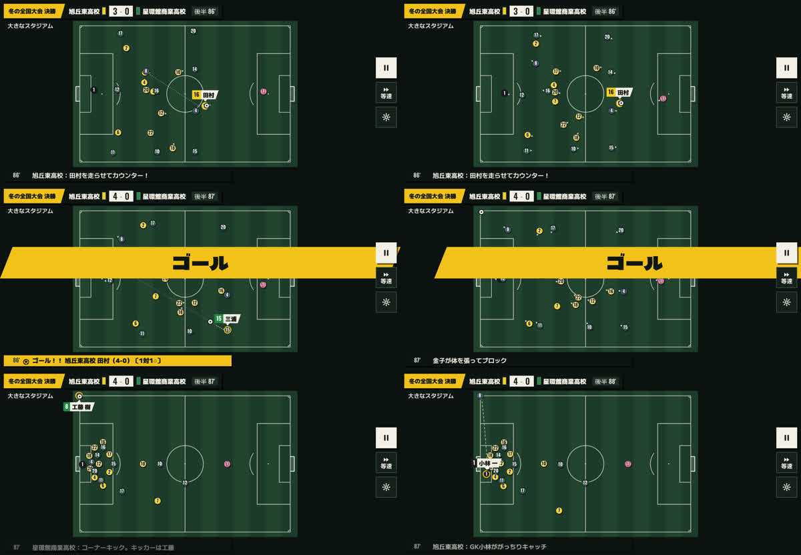 | 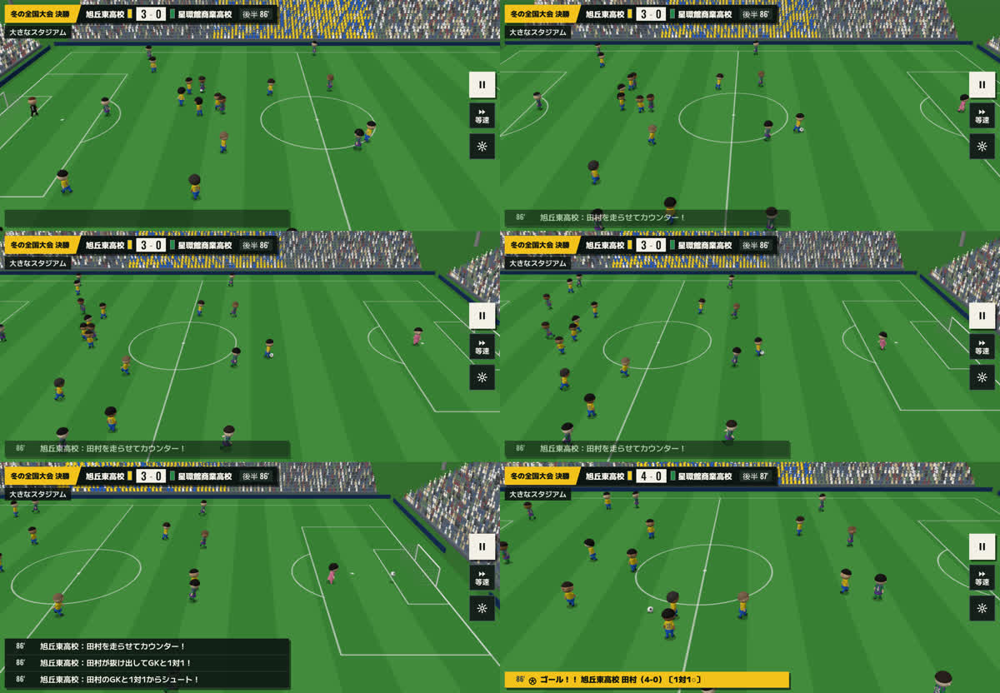 |
| コーナーキック（53〜55 分）。両チームがゴール前に集まってから蹴る。3D は選手が速報の帯の下に来ると、帯が薄く 1 行になる | 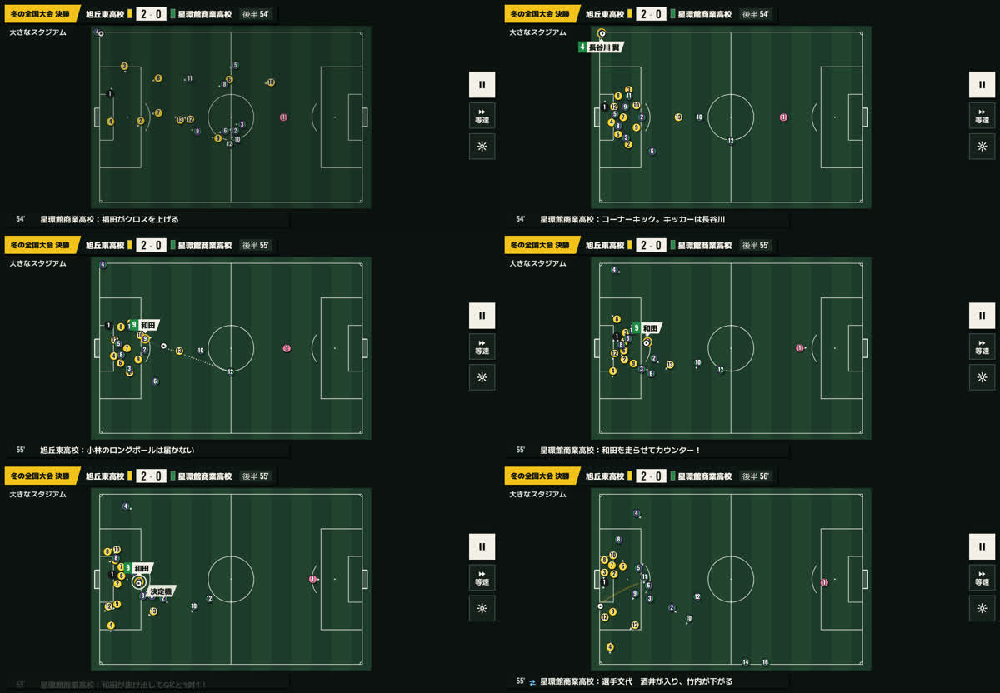 | 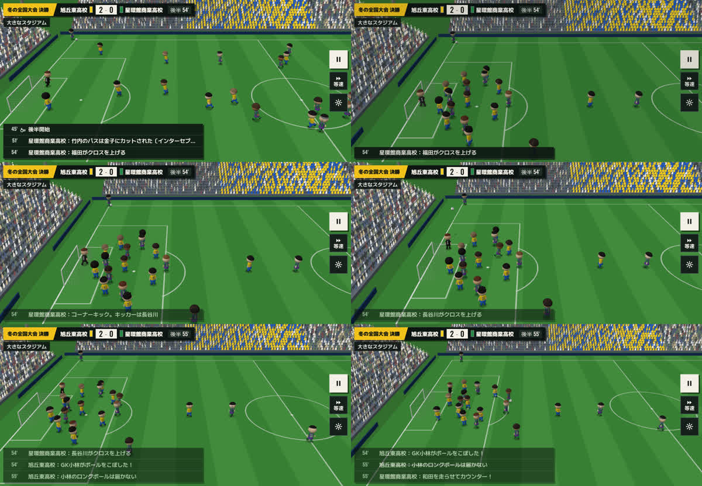 |
| ふだんの攻め（30 分） | 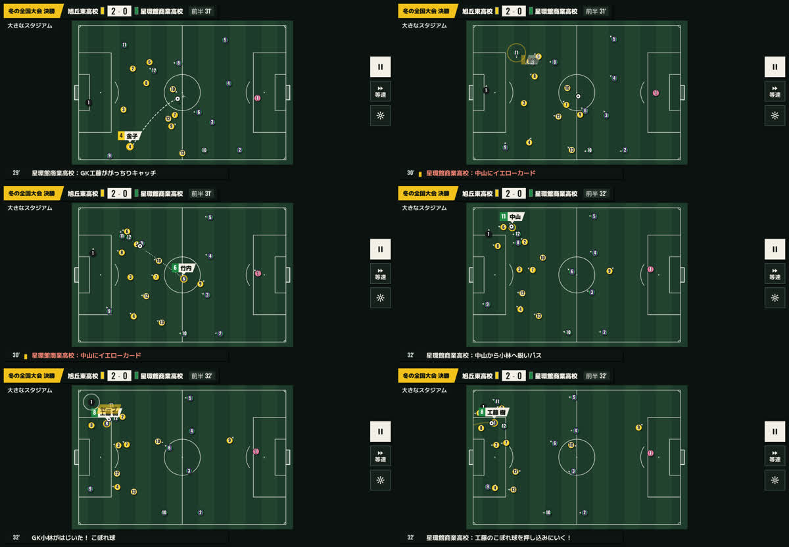 | 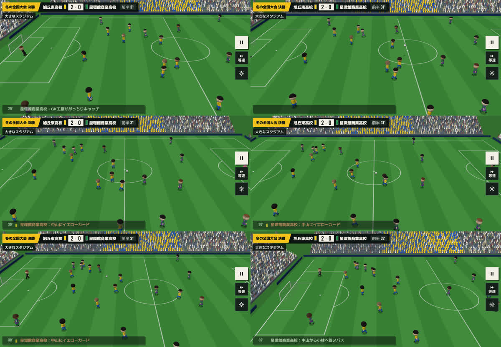 |
| 前半のゴール（9〜11 分） | 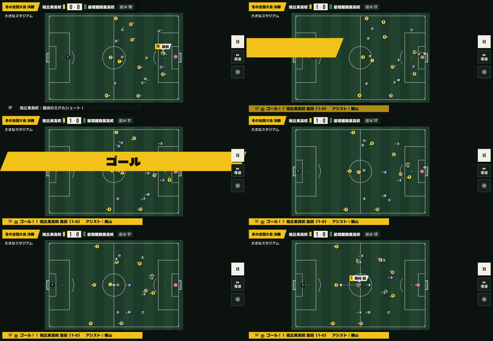 | 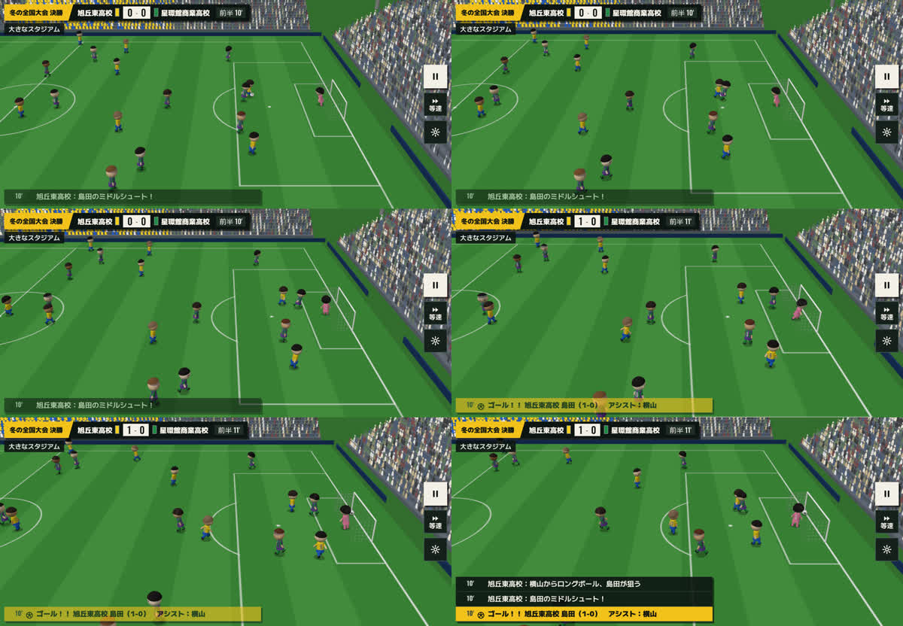 |

2D の試合の画面（一時停止中は、チームの広がりと最終ラインを重ねる）と、667×375：

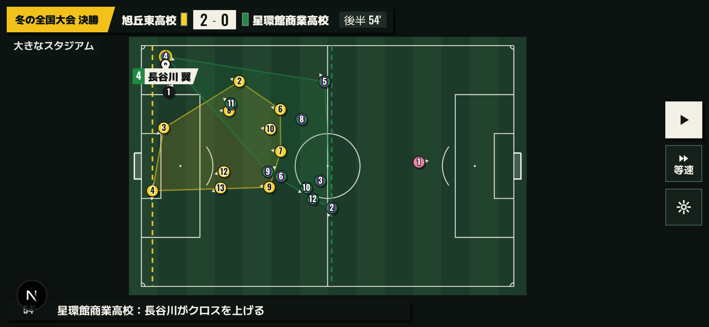
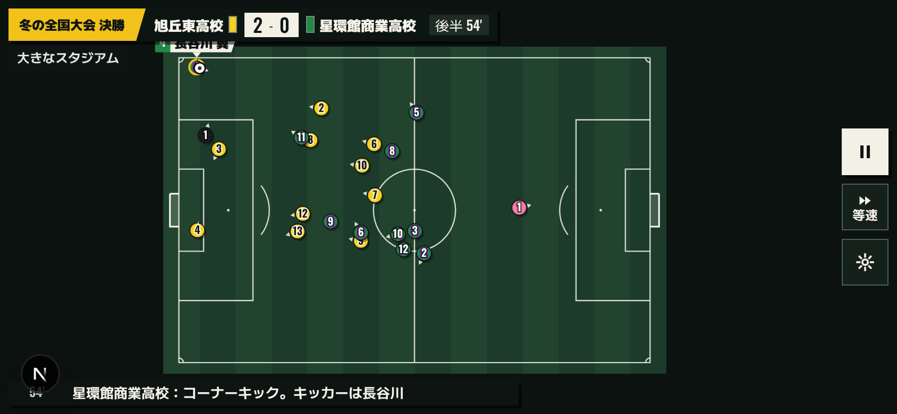
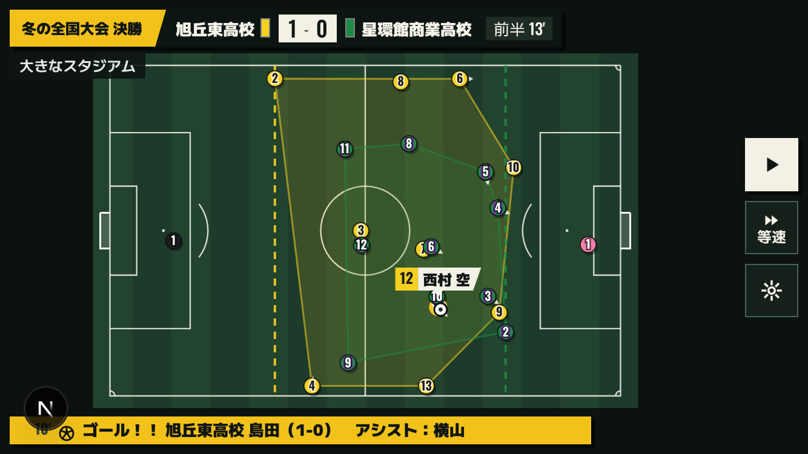

月初の指示（一覧の「重点」の列に、重点にしてからの月数と伸び。1 人の指示の画面では「判断：重点にして6か月、＋11」）：

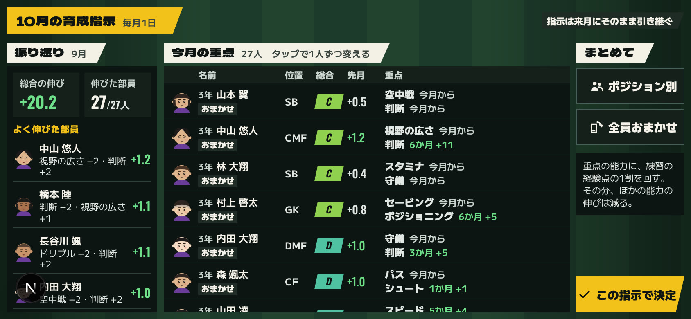
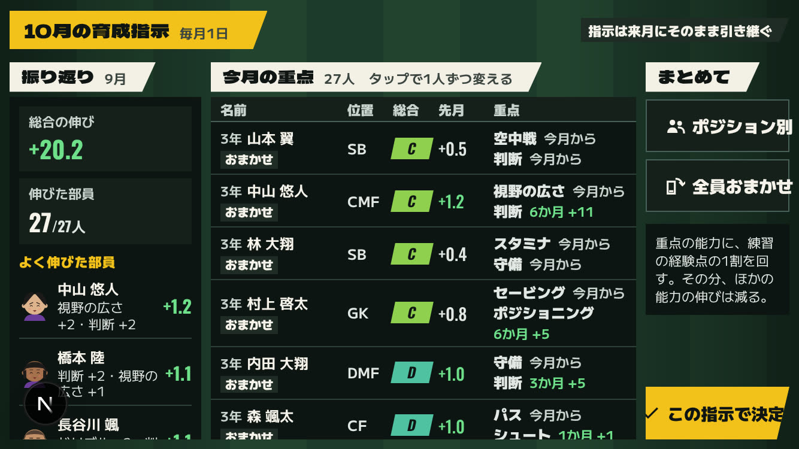
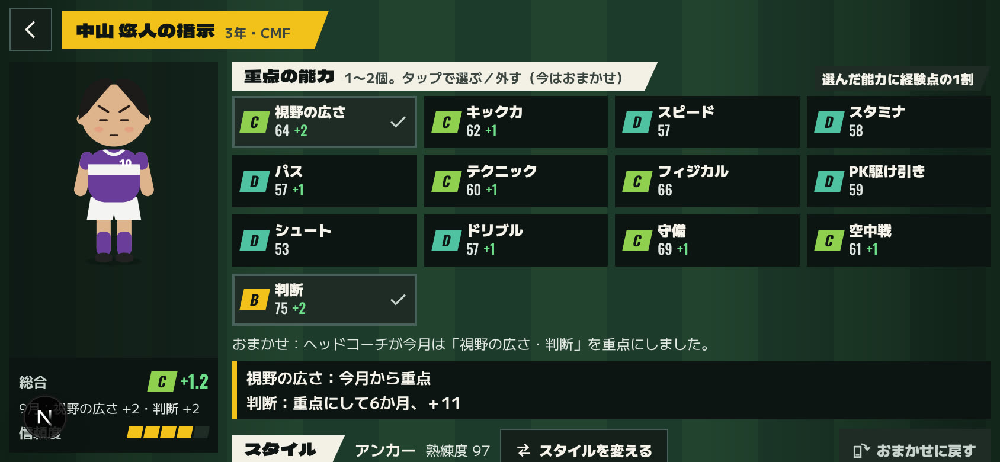

---

## 4. 動きの数値（いろいろな試合 16 試合。延長・PK 戦・退場・ケガ・交代・フォーメーションの変更を含む）

| 項目 | 結果 |
|---|---|
| ボールが関わるキー（イベント） | 1,728 件。すべて起きた（前半・後半の終わりに間に合わず、動きなしで起きたことにしたのは 8 件） |
| キーの時刻にイベントの選手とボールの距離 | 中央 0.70m・90% 1.41m・99% 2.32m・いちばん遠い 3.66m |
| 予定の時刻からの遅れ | 0.05 分を超えたのは 9.5%、0.3 分を超えたのは 2.8%（ほとんどがセットプレーで蹴る人と並びを待つとき） |
| 選手の速さ | すべての歩で上限（スピードと体力から決まる）以下 |
| 味方どうしのいちばん近い間隔 | 3.57m（2D の丸の直径 3.3m より広い） |
| シュートを打つ場所のゴールからの距離 | 中央 18m（直す前は 39m）。30m より遠いのは 27%（直す前は 66%）。7 章 |
| セットプレーの場面の切り替え | セットプレー 54 回のうち 38 回（1 試合に約 2.4 回）。6 章 |
| 1 試合の動きを作る時間 | 1 試合あたり約 0.23 秒（Node.js）。画面では 1 フレームに 40 歩（試合時間 1 分）までに区切る |

---

## 5. 確かめたこと

| 項目 | 結果 |
|---|---|
| lint・型・テスト・ビルド | すべて通る。テストは 261 件 |
| 試合の結果の指紋 | d71781a のまま（テストで確かめている） |
| `balance:quick` | main（R2）と R3 で、計算時間の行を除いて全部同じ |
| `balance:full` | 37 分。総合 B 以上の卒業生 7%（5〜8%）・金色 4.0%（2〜5%）・両利き 0.39%・名門に届く年 9 年目・全国優勝の経験 激戦区 38%・普通 50%・少数 54%。R2 の報告（5章）と同じ値 |
| セーブ | v8 のセーブ（R2 のコードで作ったもの）を読み込んで v9 にできる。重点の記録を消しても、成長と試合の結果は同じ |

全部の出力は共有フォルダの `phaseR3/balance_full_r3.txt` にある。

---

## 6. 計画からの変更・仮の部分

- **セットプレーの場面の切り替え**：エンジンの時刻の決まり（速報の分の中に入れる）では、ボールが外に出てからコーナーキックまで 0.3 分（現実の 1 秒ほど）しかないことがある。走って間に合わないときは、中継の場面の切り替えのように画面を短く暗くして（等速で前後 0.24 秒）、セットプレーの並びに置き直し、0.12 分後に蹴る。計画（1.11）の「選手は瞬間移動しない」から外れるので、7 章で決めていただきたい
- **ゴール前に並ぶ前に蹴っていた**：試作から残っていた問題で、コーナーキックの時刻が来ても攻める側がゴール前にいなかった。並ぶのを待ち（最大 0.45 分）、蹴った後もしばらく（0.4 分）並びを保つようにした。テスト：コーナーキックを蹴るとき、両チームの 4 人以上がペナルティエリアの中
- **観戦しながら作ると動きがずれることがあった**：時刻の割り付けが、動きの中で寄せたイベントの場所を使っていたため。割り付けは変えない場所だけを使うようにした（テストで、区間ごとに作っても通して作っても同じ）
- **シュートがゴールから遠い所で打たれていた**：まとめの動画を撮って見つけた。エンジンは 1 分の中に「パス → クロス → シュート」のように続けてイベントを出すが、イベントの場所は大まかな表（中盤・敵陣・ゴール前）の値なので、パスは中盤、0.3 分後のシュートはゴール前になる。選手は走って間に合わないので、動きの中でシュートの場所が選手の方へ寄せられ、中央 39m から打っていた。次の 4 つで直した（中央 18m）
  - シュートにつながる攻めのキーの場所を、打つ選手が走って間に合う所までゴールへ寄せる（`schedule.ts`。区間の中だけで決めるので、観戦しながら作っても同じ）
  - 打つ選手は、2 分前からゴール前へ向かう（パスを受けるだけの選手は、その前のキーを待たずに先へ向かう）
  - つなぎのパスを受ける約束が、受けた後も残っていて、選手がその場所に止まり続けることがあった（数分止まっていた例もあった）。受けた後に消す
  - セットプレーの場所は、蹴る人の方へ寄せない（直接 FK が 50m から打たれていた）
- **途中から再開したとき**：観戦を途中から始める（ハーフタイムの後に開き直したなど）と、動きの計算が追いつくまで、試合の初めからの動きが早送りのように見えていた。追いつくまで（1 フレーム 10 分ぶんずつ計算）は画面を暗くし、スコアと速報は予定の時刻で出す
- **3D の重さ**：この環境はソフトウェアの描画なので fps は参考にならない（10fps 前後）。動きの計算は 1 フレーム 2.4ms（CPU 4 倍遅い条件で 14.3ms）で、試作（1.1ms・10.8ms）より少し重い。実機の数値をいただいてから 4b で見直す
- **月初の指示の一覧（667×375）**：重点と累計の伸びが入るように、狭い画面では顔を省き、「指示／おまかせ」の札を名前の下に移した

---

## 7. 決めていただきたいこと

**Q1. セットプレーの前に、走って間に合わないときの場面の切り替え（短く暗くして置き直す）をこのまま使ってよいですか。**

- A（おすすめ）：このまま。テレビの中継でもリプレイの後にセットプレーへ切り替わる見え方で、速報の時刻もずれない。1 試合に 2〜3 回
- B：切り替えをやめ、選手が並ぶまで蹴るのを待つ。瞬間移動はなくなるが、コーナーキックなどが速報の分より 0.5〜1 分遅れて見え、前半・後半の終わりに間に合わないことがある

A なら SPEC 19.1 の「選手は瞬間移動しない」に「セットプレーの前に、走って間に合わないときだけ場面を切り替える」を書き足します。

**Q2. 残っている遠いシュート（30m より遠いのが 27%）を、R3 でさらに直しますか。**

残りの多くは、1 分の中に「ボールを奪う → カウンター → GK と 1 対 1 → シュート → ゴール」が全部入っている場面で、等速（試合の 1 分 = 4 秒）では選手が走って間に合わない。

- A（おすすめ）：R3 はここまで。4b で、続けて起きるイベントを前の分まで広げて置く（速報の分が 1 分ずれることがある）などを試す
- B：R3 の中で続けて直す（報告とプレビューが遅れる）

---

## 8. 次の作業（4b）

R3 の入ったプレビューで、スマホの `?demo3d=1`（冬の全国大会の決勝）の計測をお願いします。`?demo3d=1&perf=1` で fps と 1 フレームの時間が出ます。その数値で 4b（3D の動きと演出の仕上げ）の重さの目標を決めます。

---

## 9. ご回答（2026-10-17）

- Q1：A。SPEC 19.1 に「セットプレーの前に、走って間に合わないときだけ場面を切り替える」を書き足した。
- Q2：A（R3 はここまで）。4b では「決定機につながる一連のプレーのあいだだけ、表示の時計をゆっくり進める」案を先に検討する（表示だけ・速報の分はずれない・80 分の試合で観戦 6〜8 分に収める）。SPEC 19.6 に書いた。
- スマホの計測は、マージ後の本番（`https://tyoujoueleven.vercel.app/?demo3d=1&perf=1`）で、冬の全国大会の決勝を標準と軽量の両方で測っていただく。その数値で 4b の計画を作る。
